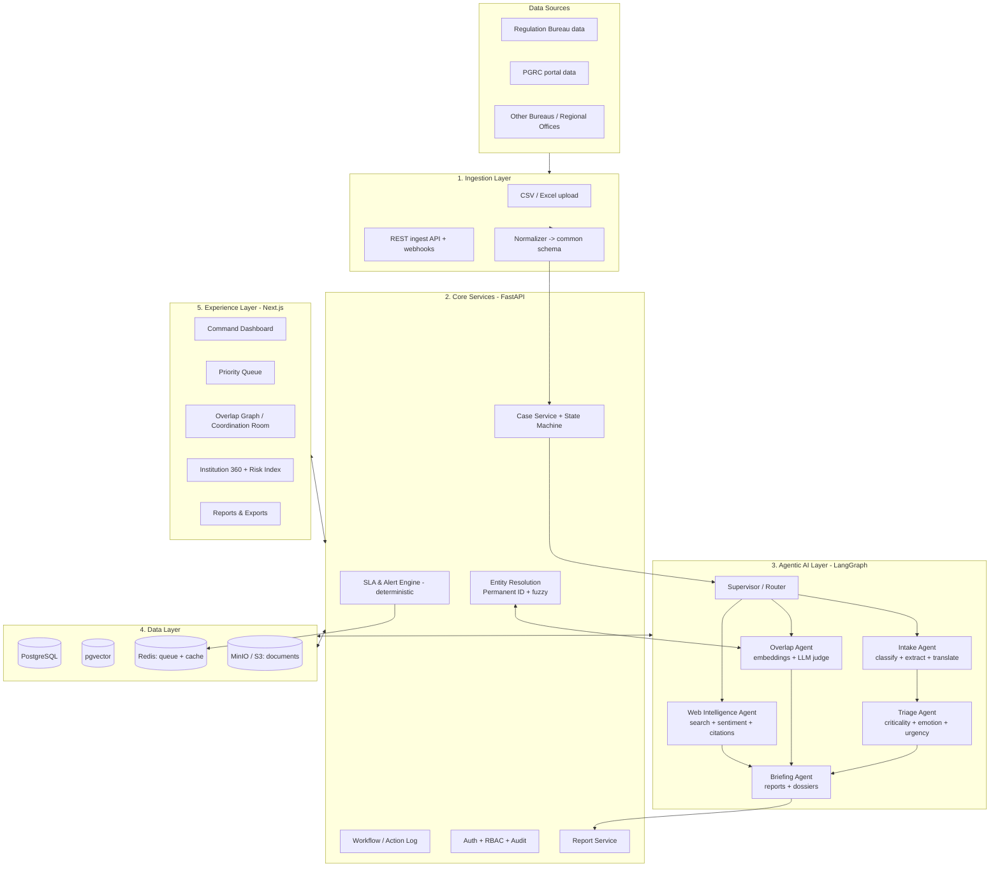
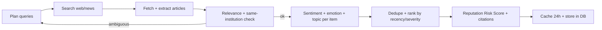
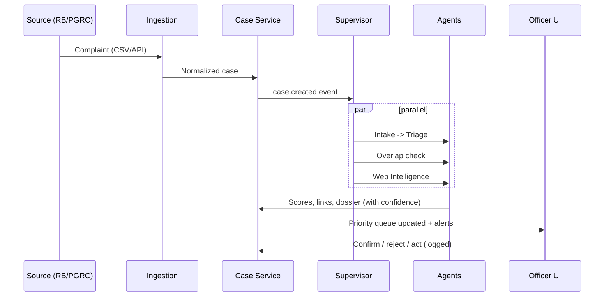

# COMPLAINT-TANTRA — Architecture

> **Complaint-Tantra** (तंत्र = "system / mechanism"): an agentic, single-window complaint intelligence dashboard for AICTE.
> SIH PS: *Integrated Dashboard for Monitoring and Tracking Institution-Related Complaint Cases Across AICTE Bureaus/Cells.*

---

## 1. One-line pitch

Not just a dashboard that *shows* complaints — a system that **understands, prioritizes, cross-checks and briefs**. AI agents read each complaint, score its criticality and emotion, detect cross-Bureau overlaps, and research the institution's public track record (news, past reports) with citations. Officers stay in control.

## 2. Design principles

| # | Principle | Why it matters for judges |
|---|-----------|---------------------------|
| 1 | **Human-in-the-loop** — AI recommends, officer decides | Government trust, no auto-disposal |
| 2 | **Explainable** — every score has reasons + confidence | Overlap alerts get believed, not ignored |
| 3 | **Deterministic core, agentic edge** — SLA, RBAC, status flow are plain code; LLMs only do understanding/research | Reliable + auditable |
| 4 | **Append-only audit log** | Accountability, the PS explicitly asks for it |
| 5 | **Cited intelligence** — web findings always carry source URL + date | No hallucinated "news" |
| 6 | **Privacy-ready** — PII masking, swappable to on-prem LLM | AICTE data is confidential |
| 7 | **Free/open stack, Docker-deployable** | Feasible + cheap to scale |

---

## 3. High-level architecture



---

## 4. Layer-by-layer

### 4.1 Ingestion layer
- Accepts CSV/Excel + REST (`POST /ingest/cases`) because RB and PGRC use different systems.
- **Normalizer** maps any source into one **common case schema** (see `Complaint-Tantra_system.md`).
- Pitch line: *"In production this becomes read-only API/DB connectors per Bureau; the common schema stays unchanged."*

### 4.2 Core services (deterministic, no LLM)
| Service | Responsibility |
|---|---|
| Case Service | CRUD, status state machine, linking cases |
| Entity Resolution | Canonical institution records; Permanent ID match first, fuzzy second |
| Workflow / Action Log | Append-only timestamped actions: who, what, remarks, docs, transfers, escalations |
| SLA & Alert Engine | Per-category SLA, due-soon / overdue / stuck-case alerts via scheduled jobs |
| Auth / RBAC | JWT, role + region scoped views, audit trail |
| Report Service | Institution / Bureau / region / status / ageing / disposal-rate reports (PDF/CSV) |

### 4.3 Agentic AI layer (the differentiator)

Orchestrated with **LangGraph** (stateful graph, retries, human-approval checkpoints).

| Agent | Input | Output | Tools |
|---|---|---|---|
| **Supervisor** | New/updated case event | Routes to the right agents, merges results | LangGraph router |
| **Intake Agent** | Raw complaint text (Hindi/English/regional) | Category, sub-category, entities (institution, people, amounts, dates), language, clean English summary | Translator, NER, PII masker |
| **Triage Agent** | Intake output + SLA data | `criticality` (C1–C4), `emotion` + intensity, `urgency`, **Priority Score 0–100**, reasons | LLM + rules + time-decay formula |
| **Overlap Agent** | New case + institution's open cases | Overlap tier, **confidence %**, evidence, "Coordination Required" suggestion | pgvector similarity, rapidfuzz, LLM judge |
| **Web Intelligence Agent** | Institution name + ID + city | News items, past public reports/court/regulatory mentions, **sentiment per item**, reputation trend, **Reputation Risk Score**, citations | Web search API, article extractor, sentiment/emotion model |
| **Briefing Agent** | All of the above | 1-page **Case Brief**, **Institution Dossier**, daily "Top 10 needing attention" digest, periodic reports | Templates + LLM + chart data |

**Agent loop (Web Intelligence Agent) — shows real "agentic" behaviour:**



The agent *re-plans* when results are ambiguous (e.g., two colleges with the same name in different states) — it adds city/state/Permanent ID to the query and retries.

### 4.4 Data layer
- **PostgreSQL** — institutions, cases, actions, links, users, alerts, agent runs.
- **pgvector** — complaint-text embeddings + institution-name embeddings (one DB, less ops).
- **Redis** — Celery/arq job queue, rate limiting, web-result cache.
- **MinIO (S3-compatible)** — complaint attachments, generated PDFs.

### 4.5 Experience layer (Next.js)
| Screen | What the officer sees |
|---|---|
| **Command Dashboard** | Totals, pending, under process, disposed, transferred, overdue, escalated; Bureau workload; region heatmap |
| **Priority Queue** | Cases sorted by Priority Score with chips: criticality, emotion, time left |
| **Overlap / Coordination Room** | Graph of linked cases across Bureaus, confidence %, confirm / reject / link buttons |
| **Institution 360** | Profile, full complaint history, Reputation Risk Score, news timeline with sentiment, AI dossier |
| **Case Detail** | Timeline, action log, AI brief, evidence, related cases |
| **Reports** | Filterable reports, ageing analysis, disposal rate, export PDF/CSV |
| **Alerts** | Overlap, due-soon, overdue, escalation |

---

## 5. Key flows

### 5.1 New complaint arrives


### 5.2 Overlap detection (the PS's "key innovation")
1. **Exact**: Permanent ID match → candidate set = other Bureaus' open cases for that institution.
2. **Fuzzy**: if ID missing → normalize name (strip "Engg.", punctuation, abbreviations) → rapidfuzz token-set ratio + address/region match + embedding similarity of institution name.
3. **Issue-level**: embed complaint text → cosine similarity with candidates' text, plus category relation.
4. **LLM judge** (only for gray-zone scores) → explains *why* related.
5. Output tiers:

| Tier | Meaning | UI label |
|---|---|---|
| T1 | Same institution + same/related issue + overlapping window | 🔴 Potential Overlapping Cases – Coordination Required |
| T2 | Same institution, different issue | 🟠 Same Institution – Different Issue |
| T3 | Possible duplicate complaint (same complainant/text) | 🟡 Possible Duplicate |

6. Officer confirms/rejects → stored as labelled feedback → used to tune thresholds (shown as a precision/recall chart in demo).

### 5.3 Priority scoring (summary; formula in `Complaint-Tantra_system.md`)
`Priority = weighted(criticality, emotion intensity, time pressure, institution risk, overlap bonus)` — each component is stored and displayed, so the officer sees *why* it is #1.

---

## 6. Technology choices

| Concern | Choice | Reason |
|---|---|---|
| Frontend | **Next.js + TypeScript + Tailwind + shadcn/ui** | Fast, polished UI |
| Charts / graph / map | **Recharts**, **React Flow** (overlap graph), **Leaflet** + India GeoJSON | Region + relationship views |
| Backend | **FastAPI (Python)** | Same language as AI stack, async, auto API docs |
| DB | **PostgreSQL 16 + pgvector** | Relational + vector in one |
| Jobs / scheduler | **Celery (or arq) + Redis**, Celery Beat for SLA checks | Alerts, agent runs, report generation |
| Agent orchestration | **LangGraph** | Stateful graphs, human-in-loop checkpoints |
| LLM | **Provider-agnostic** (LiteLLM wrapper): Claude / Gemini for demo, **Llama 3.x / Qwen via Ollama or vLLM** for on-prem story | Swap without code change |
| Embeddings | **bge-m3 or multilingual-e5** (multilingual, open source) | Hindi + English complaints |
| Fuzzy matching | **rapidfuzz** + custom normalizer | Fast, battle-tested |
| Sentiment / emotion | LLM zero-shot with fixed JSON schema + optional **XLM-RoBERTa sentiment** model as cheap first pass | Accuracy + cost control |
| Web search | **Tavily / SerpAPI / Brave Search API**, plus **Google News RSS / GDELT** as free fallback; **trafilatura** for article text | Reliable, citable |
| Auth | **JWT + RBAC** (role + region + bureau scope) | PS requirement |
| Files | **MinIO** | S3-compatible, self-hosted |
| Observability | **Langfuse** (LLM traces), Prometheus/Grafana optional | Show agent transparency |
| Testing/eval | **pytest**, custom eval harness on synthetic data | Provable accuracy numbers |
| Deploy | **Docker Compose** → Render/Railway/AWS free tier | One-command demo |
| Synthetic data | **Faker** + messy-name generator + scripted overlaps | No real data available |

> Verify current model names/pricing/free-tier limits before locking the stack; the architecture is model-agnostic on purpose.

---

## 7. Security, privacy & responsible AI

- **RBAC matrix** with region/bureau scoping; Competent Authority = read-all + approve.
- **Audit log** is append-only; every AI output stored with model, prompt version, timestamp.
- **PII masking** before any text leaves to an external LLM (names, phone, Aadhaar-like patterns); on-prem LLM option for fully sensitive deployments.
- **AI never changes case status or disposes a case.** It suggests; officer clicks.
- **Web intelligence guardrails**: only public sources, always cite, show retrieval date, flag low-confidence matches, never treat news sentiment as proof of a violation.
- **Emotion handling**: signals of self-harm/ragging/safety threats trigger an *urgent human review flag*, not an automated response.
- **Bias check**: evaluate triage consistency across languages and regions.

---

## 8. Scalability & performance

| Challenge | Approach |
|---|---|
| Lakhs of cases | Indexes + **materialized views** refreshed by jobs for dashboard aggregates |
| LLM latency/cost | Run agents **async** on ingest, cache results, use cheap model first, escalate to big model only for gray-zone |
| Web search cost | 24h cache per institution; refresh only on new case or manual trigger |
| Burst ingestion | Queue-based workers, horizontally scalable |
| Vector search | HNSW index in pgvector |

---

## 9. Deployment view

```
┌────────────────────────── Docker Compose ──────────────────────────┐
│ web (Next.js) │ api (FastAPI) │ worker (Celery) │ beat (scheduler) │
│ postgres+pgvector │ redis │ minio │ ollama (optional) │ langfuse   │
└────────────────────────────────────────────────────────────────────┘
        ▲ Nginx / Caddy reverse proxy + HTTPS
```

---

## 10. Why this wins (mapping to judging)

| Judging lens | What we show |
|---|---|
| **Innovation** | Explainable overlap detection + agentic web intelligence + emotion-aware triage |
| **Technical depth** | Multi-agent graph, hybrid fuzzy+vector matching, state machine, RBAC, evals |
| **Feasibility** | Common-schema ingestion, free/open stack, Docker, on-prem LLM option |
| **Impact** | Fewer duplicate actions, faster disposal, ageing/SLA visibility |
| **Usability** | One-window dashboard, priority queue, one-page AI briefs |
| **Responsible AI** | Human-in-loop, citations, audit, PII masking |
| **Demo-ability** | Synthetic data with scripted "wow" scenario (see PRD §12) |
