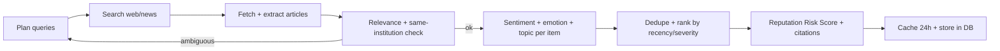
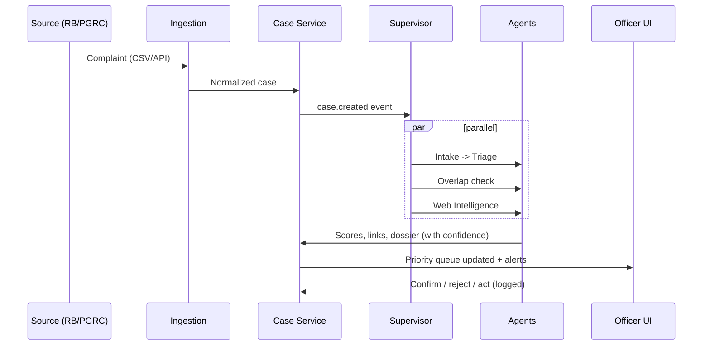

# COMPLAINT-TANTRA — Architecture

> **Complaint-Tantra** (तंत्र = "system / mechanism"): an agentic, single-window complaint intelligence dashboard for AICTE.
> SIH PS: *Integrated Dashboard for Monitoring and Tracking Institution-Related Complaint Cases Across AICTE Bureaus/Cells.*

---

## 1. One-line pitch

Not just a dashboard that *shows* complaints — a system that **understands, prioritizes, cross-checks and briefs**. AI agents read each complaint, score its criticality and emotion, detect cross-Bureau overlaps, and research the institution's public track record (news, past reports) with citations. Officers stay in control.

## 2. Design principles

| # | Principle | Why it matters for judges |
|---|-----------|---------------------------|
| 1 | **Human-in-the-loop** — AI recommends, officer decides | Government trust, no auto-disposal |
| 2 | **Explainable** — every score has reasons + confidence | Overlap alerts get believed, not ignored |
| 3 | **Deterministic core, agentic edge** — SLA, RBAC, status flow are plain code; LLMs only do understanding/research | Reliable + auditable |
| 4 | **Append-only audit log** | Accountability, the PS explicitly asks for it |
| 5 | **Cited intelligence** — web findings always carry source URL + date | No hallucinated "news" |
| 6 | **Privacy-ready** — PII masking, swappable to on-prem LLM | AICTE data is confidential |
| 7 | **Free/open stack, Docker-deployable** | Feasible + cheap to scale |

---

## 3. High-level architecture

```drawio
<mxfile>
  <diagram id="Szcm8Fw_vbPghQb0EFod" name="Page-1">
    <mxGraphModel dx="1365" dy="377" grid="1" gridSize="10" guides="1" tooltips="0" connect="1" arrows="1" fold="1" page="1" pageScale="1" pageWidth="827" pageHeight="1169" math="0" shadow="0">
      <root>
        <mxCell id="0" />
        <mxCell id="1" parent="0" />
        <UserObject label="" mermaidData="{&#xa;  &quot;data&quot;: &quot;flowchart TB\n    subgraph SRC[Data Sources]\n        RB[Regulation Bureau data]\n        PG[PGRC portal data]\n        OB[Other Bureaus / Regional Offices]\n    end\n\n    subgraph ING[1. Ingestion Layer]\n        UP[CSV / Excel upload]\n        API[REST ingest API + webhooks]\n        NORM[Normalizer -&gt; common schema]\n    end\n\n    subgraph CORE[2. Core Services - FastAPI]\n        ER[Entity Resolution\\nPermanent ID + fuzzy]\n        CS[Case Service + State Machine]\n        WF[Workflow / Action Log]\n        RBAC[Auth + RBAC + Audit]\n        SLA[SLA &amp; Alert Engine - deterministic]\n        RPT[Report Service]\n    end\n\n    subgraph AGENTS[3. Agentic AI Layer - LangGraph]\n        SUP[Supervisor / Router]\n        IA[Intake Agent\\nclassify + extract + translate]\n        TA[Triage Agent\\ncriticality + emotion + urgency]\n        OA[Overlap Agent\\nembeddings + LLM judge]\n        WA[Web Intelligence Agent\\nsearch + sentiment + citations]\n        BA[Briefing Agent\\nreports + dossiers]\n    end\n\n    subgraph DATA[4. Data Layer]\n        PGDB[(PostgreSQL)]\n        VEC[(pgvector)]\n        REDIS[(Redis: queue + cache)]\n        OBJ[(MinIO / S3: documents)]\n    end\n\n    subgraph UI[5. Experience Layer - Next.js]\n        DASH[Command Dashboard]\n        QUEUE[Priority Queue]\n        GRAPH[Overlap Graph / Coordination Room]\n        I360[Institution 360 + Risk Index]\n        REP[Reports &amp; Exports]\n    end\n\n    SRC --&gt; ING --&gt; NORM --&gt; CS\n    CS --&gt; SUP\n    SUP --&gt; IA --&gt; TA\n    SUP --&gt; OA\n    SUP --&gt; WA\n    TA --&gt; BA\n    OA --&gt; BA\n    WA --&gt; BA\n    ER &lt;--&gt; OA\n    CORE &lt;--&gt; DATA\n    AGENTS &lt;--&gt; DATA\n    SLA --&gt; REDIS\n    UI &lt;--&gt; CORE\n    BA --&gt; RPT&quot;,&#xa;  &quot;config&quot;: null&#xa;}" id="52">
          <mxCell connectable="0" parent="1" style="group;transparentBounds=1;editIcon=1;lockedGroup=0;groupPadding=10;" vertex="1">
            <mxGeometry as="geometry" />
          </mxCell>
        </UserObject>
        <UserObject label="Data Sources" mermaidId="n:SRC" mermaidBaseStyle="html=1;whiteSpace=wrap;strokeWidth=1;verticalAlign=top;fillColor=light-dark(#ffffde,#1f2020);strokeColor=light-dark(#aaaa33,#cccccc);fontColor=light-dark(#333333,#cccccc);fontFamily=Trebuchet MS,Verdana,Arial,sans-serif;fontSize=16;" mermaidBaseValue="Data Sources" id="2">
          <mxCell parent="52" style="html=1;whiteSpace=wrap;strokeWidth=1;verticalAlign=top;fillColor=light-dark(#ffffde,#1f2020);strokeColor=light-dark(#aaaa33,#cccccc);fontColor=light-dark(#333333,#cccccc);fontFamily=Trebuchet MS,Verdana,Arial,sans-serif;fontSize=16;" vertex="1">
            <mxGeometry height="327" width="366" x="841" y="10" as="geometry" />
          </mxCell>
        </UserObject>
        <UserObject label="Regulation Bureau data" mermaidId="n:RB" mermaidBaseStyle="html=1;whiteSpace=wrap;strokeWidth=1;fillColor=light-dark(#ECECFF,#1f2020);strokeColor=light-dark(#9370DB,#cccccc);fontColor=light-dark(#333333,#cccccc);fontFamily=Trebuchet MS,Verdana,Arial,sans-serif;fontSize=16;" mermaidBaseValue="Regulation Bureau data" id="3">
          <mxCell parent="2" style="html=1;whiteSpace=wrap;strokeWidth=1;fillColor=light-dark(#ECECFF,#1f2020);strokeColor=light-dark(#9370DB,#cccccc);fontColor=light-dark(#333333,#cccccc);fontFamily=Trebuchet MS,Verdana,Arial,sans-serif;fontSize=16;" vertex="1">
            <mxGeometry height="54" width="227" x="70" y="45" as="geometry" />
          </mxCell>
        </UserObject>
        <UserObject label="PGRC portal data" mermaidId="n:PG" mermaidBaseStyle="html=1;whiteSpace=wrap;strokeWidth=1;fillColor=light-dark(#ECECFF,#1f2020);strokeColor=light-dark(#9370DB,#cccccc);fontColor=light-dark(#333333,#cccccc);fontFamily=Trebuchet MS,Verdana,Arial,sans-serif;fontSize=16;" mermaidBaseValue="PGRC portal data" id="4">
          <mxCell parent="2" style="html=1;whiteSpace=wrap;strokeWidth=1;fillColor=light-dark(#ECECFF,#1f2020);strokeColor=light-dark(#9370DB,#cccccc);fontColor=light-dark(#333333,#cccccc);fontFamily=Trebuchet MS,Verdana,Arial,sans-serif;fontSize=16;" vertex="1">
            <mxGeometry height="54" width="184" x="91" y="149" as="geometry" />
          </mxCell>
        </UserObject>
        <UserObject label="Other Bureaus / Regional Offices" mermaidId="n:OB" mermaidBaseStyle="html=1;whiteSpace=wrap;strokeWidth=1;fillColor=light-dark(#ECECFF,#1f2020);strokeColor=light-dark(#9370DB,#cccccc);fontColor=light-dark(#333333,#cccccc);fontFamily=Trebuchet MS,Verdana,Arial,sans-serif;fontSize=16;" mermaidBaseValue="Other Bureaus / Regional Offices" id="5">
          <mxCell parent="2" style="html=1;whiteSpace=wrap;strokeWidth=1;fillColor=light-dark(#ECECFF,#1f2020);strokeColor=light-dark(#9370DB,#cccccc);fontColor=light-dark(#333333,#cccccc);fontFamily=Trebuchet MS,Verdana,Arial,sans-serif;fontSize=16;" vertex="1">
            <mxGeometry height="54" width="296" x="35" y="253" as="geometry" />
          </mxCell>
        </UserObject>
        <UserObject label="1. Ingestion Layer" mermaidId="n:ING" mermaidBaseStyle="html=1;whiteSpace=wrap;strokeWidth=1;verticalAlign=top;fillColor=light-dark(#ffffde,#1f2020);strokeColor=light-dark(#aaaa33,#cccccc);fontColor=light-dark(#333333,#cccccc);fontFamily=Trebuchet MS,Verdana,Arial,sans-serif;fontSize=16;" mermaidBaseValue="1. Ingestion Layer" id="6">
          <mxCell parent="52" style="html=1;whiteSpace=wrap;strokeWidth=1;verticalAlign=top;fillColor=light-dark(#ffffde,#1f2020);strokeColor=light-dark(#aaaa33,#cccccc);fontColor=light-dark(#333333,#cccccc);fontFamily=Trebuchet MS,Verdana,Arial,sans-serif;fontSize=16;" vertex="1">
            <mxGeometry height="228" width="1090" x="848" y="367" as="geometry" />
          </mxCell>
        </UserObject>
        <UserObject label="CSV / Excel upload" mermaidId="n:UP" mermaidBaseStyle="html=1;whiteSpace=wrap;strokeWidth=1;fillColor=light-dark(#ECECFF,#1f2020);strokeColor=light-dark(#9370DB,#cccccc);fontColor=light-dark(#333333,#cccccc);fontFamily=Trebuchet MS,Verdana,Arial,sans-serif;fontSize=16;" mermaidBaseValue="CSV / Excel upload" id="7">
          <mxCell parent="6" style="html=1;whiteSpace=wrap;strokeWidth=1;fillColor=light-dark(#ECECFF,#1f2020);strokeColor=light-dark(#9370DB,#cccccc);fontColor=light-dark(#333333,#cccccc);fontFamily=Trebuchet MS,Verdana,Arial,sans-serif;fontSize=16;" vertex="1">
            <mxGeometry height="54" width="196" x="78" y="45" as="geometry" />
          </mxCell>
        </UserObject>
        <UserObject label="REST ingest API + webhooks" mermaidId="n:API" mermaidBaseStyle="html=1;whiteSpace=wrap;strokeWidth=1;fillColor=light-dark(#ECECFF,#1f2020);strokeColor=light-dark(#9370DB,#cccccc);fontColor=light-dark(#333333,#cccccc);fontFamily=Trebuchet MS,Verdana,Arial,sans-serif;fontSize=16;" mermaidBaseValue="REST ingest API + webhooks" id="8">
          <mxCell parent="6" style="html=1;whiteSpace=wrap;strokeWidth=1;fillColor=light-dark(#ECECFF,#1f2020);strokeColor=light-dark(#9370DB,#cccccc);fontColor=light-dark(#333333,#cccccc);fontFamily=Trebuchet MS,Verdana,Arial,sans-serif;fontSize=16;" vertex="1">
            <mxGeometry height="54" width="257" x="798" y="149" as="geometry" />
          </mxCell>
        </UserObject>
        <UserObject label="Normalizer -&gt; common schema" mermaidId="n:NORM" mermaidBaseStyle="html=1;whiteSpace=wrap;strokeWidth=1;fillColor=light-dark(#ECECFF,#1f2020);strokeColor=light-dark(#9370DB,#cccccc);fontColor=light-dark(#333333,#cccccc);fontFamily=Trebuchet MS,Verdana,Arial,sans-serif;fontSize=16;" mermaidBaseValue="Normalizer -&gt; common schema" id="9">
          <mxCell parent="6" style="html=1;whiteSpace=wrap;strokeWidth=1;fillColor=light-dark(#ECECFF,#1f2020);strokeColor=light-dark(#9370DB,#cccccc);fontColor=light-dark(#333333,#cccccc);fontFamily=Trebuchet MS,Verdana,Arial,sans-serif;fontSize=16;" vertex="1">
            <mxGeometry height="54" width="281" x="35" y="149" as="geometry" />
          </mxCell>
        </UserObject>
        <UserObject label="2. Core Services - FastAPI" mermaidId="n:CORE" mermaidBaseStyle="html=1;whiteSpace=wrap;strokeWidth=1;verticalAlign=top;fillColor=light-dark(#ffffde,#1f2020);strokeColor=light-dark(#aaaa33,#cccccc);fontColor=light-dark(#333333,#cccccc);fontFamily=Trebuchet MS,Verdana,Arial,sans-serif;fontSize=16;" mermaidBaseValue="2. Core Services - FastAPI" id="10">
          <mxCell parent="52" style="html=1;whiteSpace=wrap;strokeWidth=1;verticalAlign=top;fillColor=light-dark(#ffffde,#1f2020);strokeColor=light-dark(#aaaa33,#cccccc);fontColor=light-dark(#333333,#cccccc);fontFamily=Trebuchet MS,Verdana,Arial,sans-serif;fontSize=16;" vertex="1">
            <mxGeometry height="997" width="2025" x="439" y="866" as="geometry" />
          </mxCell>
        </UserObject>
        <UserObject label="Entity Resolution&#xa;Permanent ID + fuzzy" mermaidId="n:ER" mermaidBaseStyle="html=1;whiteSpace=wrap;strokeWidth=1;fillColor=light-dark(#ECECFF,#1f2020);strokeColor=light-dark(#9370DB,#cccccc);fontColor=light-dark(#333333,#cccccc);fontFamily=Trebuchet MS,Verdana,Arial,sans-serif;fontSize=16;" mermaidBaseValue="Entity Resolution&#xa;Permanent ID + fuzzy" id="11">
          <mxCell parent="10" style="html=1;whiteSpace=wrap;strokeWidth=1;fillColor=light-dark(#ECECFF,#1f2020);strokeColor=light-dark(#9370DB,#cccccc);fontColor=light-dark(#333333,#cccccc);fontFamily=Trebuchet MS,Verdana,Arial,sans-serif;fontSize=16;" vertex="1">
            <mxGeometry height="54" width="348" x="381" y="414" as="geometry" />
          </mxCell>
        </UserObject>
        <UserObject label="Case Service + State Machine" mermaidId="n:CS" mermaidBaseStyle="html=1;whiteSpace=wrap;strokeWidth=1;fillColor=light-dark(#ECECFF,#1f2020);strokeColor=light-dark(#9370DB,#cccccc);fontColor=light-dark(#333333,#cccccc);fontFamily=Trebuchet MS,Verdana,Arial,sans-serif;fontSize=16;" mermaidBaseValue="Case Service + State Machine" id="12">
          <mxCell parent="10" style="html=1;whiteSpace=wrap;strokeWidth=1;fillColor=light-dark(#ECECFF,#1f2020);strokeColor=light-dark(#9370DB,#cccccc);fontColor=light-dark(#333333,#cccccc);fontFamily=Trebuchet MS,Verdana,Arial,sans-serif;fontSize=16;" vertex="1">
            <mxGeometry height="54" width="269" x="450" y="45" as="geometry" />
          </mxCell>
        </UserObject>
        <UserObject label="Workflow / Action Log" mermaidId="n:WF" mermaidBaseStyle="html=1;whiteSpace=wrap;strokeWidth=1;fillColor=light-dark(#ECECFF,#1f2020);strokeColor=light-dark(#9370DB,#cccccc);fontColor=light-dark(#333333,#cccccc);fontFamily=Trebuchet MS,Verdana,Arial,sans-serif;fontSize=16;" mermaidBaseValue="Workflow / Action Log" id="13">
          <mxCell parent="10" style="html=1;whiteSpace=wrap;strokeWidth=1;fillColor=light-dark(#ECECFF,#1f2020);strokeColor=light-dark(#9370DB,#cccccc);fontColor=light-dark(#333333,#cccccc);fontFamily=Trebuchet MS,Verdana,Arial,sans-serif;fontSize=16;" vertex="1">
            <mxGeometry height="54" width="219" x="1517" y="918" as="geometry" />
          </mxCell>
        </UserObject>
        <UserObject label="Auth + RBAC + Audit" mermaidId="n:RBAC" mermaidBaseStyle="html=1;whiteSpace=wrap;strokeWidth=1;fillColor=light-dark(#ECECFF,#1f2020);strokeColor=light-dark(#9370DB,#cccccc);fontColor=light-dark(#333333,#cccccc);fontFamily=Trebuchet MS,Verdana,Arial,sans-serif;fontSize=16;" mermaidBaseValue="Auth + RBAC + Audit" id="14">
          <mxCell parent="10" style="html=1;whiteSpace=wrap;strokeWidth=1;fillColor=light-dark(#ECECFF,#1f2020);strokeColor=light-dark(#9370DB,#cccccc);fontColor=light-dark(#333333,#cccccc);fontFamily=Trebuchet MS,Verdana,Arial,sans-serif;fontSize=16;" vertex="1">
            <mxGeometry height="54" width="204" x="1786" y="918" as="geometry" />
          </mxCell>
        </UserObject>
        <UserObject label="SLA &amp; Alert Engine - deterministic" mermaidId="n:SLA" mermaidBaseStyle="html=1;whiteSpace=wrap;strokeWidth=1;fillColor=light-dark(#ECECFF,#1f2020);strokeColor=light-dark(#9370DB,#cccccc);fontColor=light-dark(#333333,#cccccc);fontFamily=Trebuchet MS,Verdana,Arial,sans-serif;fontSize=16;" mermaidBaseValue="SLA &amp; Alert Engine - deterministic" id="15">
          <mxCell parent="10" style="html=1;whiteSpace=wrap;strokeWidth=1;fillColor=light-dark(#ECECFF,#1f2020);strokeColor=light-dark(#9370DB,#cccccc);fontColor=light-dark(#333333,#cccccc);fontFamily=Trebuchet MS,Verdana,Arial,sans-serif;fontSize=16;" vertex="1">
            <mxGeometry height="54" width="303" x="1026" y="414" as="geometry" />
          </mxCell>
        </UserObject>
        <UserObject label="Report Service" mermaidId="n:RPT" mermaidBaseStyle="html=1;whiteSpace=wrap;strokeWidth=1;fillColor=light-dark(#ECECFF,#1f2020);strokeColor=light-dark(#9370DB,#cccccc);fontColor=light-dark(#333333,#cccccc);fontFamily=Trebuchet MS,Verdana,Arial,sans-serif;fontSize=16;" mermaidBaseValue="Report Service" id="16">
          <mxCell parent="10" style="html=1;whiteSpace=wrap;strokeWidth=1;fillColor=light-dark(#ECECFF,#1f2020);strokeColor=light-dark(#9370DB,#cccccc);fontColor=light-dark(#333333,#cccccc);fontFamily=Trebuchet MS,Verdana,Arial,sans-serif;fontSize=16;" vertex="1">
            <mxGeometry height="54" width="164" x="35" y="918" as="geometry" />
          </mxCell>
        </UserObject>
        <UserObject label="3. Agentic AI Layer - LangGraph" mermaidId="n:AGENTS" mermaidBaseStyle="html=1;whiteSpace=wrap;strokeWidth=1;verticalAlign=top;fillColor=light-dark(#ffffde,#1f2020);strokeColor=light-dark(#aaaa33,#cccccc);fontColor=light-dark(#333333,#cccccc);fontFamily=Trebuchet MS,Verdana,Arial,sans-serif;fontSize=16;" mermaidBaseValue="3. Agentic AI Layer - LangGraph" id="17">
          <mxCell parent="52" style="html=1;whiteSpace=wrap;strokeWidth=1;verticalAlign=top;fillColor=light-dark(#ffffde,#1f2020);strokeColor=light-dark(#aaaa33,#cccccc);fontColor=light-dark(#333333,#cccccc);fontFamily=Trebuchet MS,Verdana,Arial,sans-serif;fontSize=16;" vertex="1">
            <mxGeometry height="499" width="1163" x="1979" y="1235" as="geometry" />
          </mxCell>
        </UserObject>
        <UserObject label="Supervisor / Router" mermaidId="n:SUP" mermaidBaseStyle="html=1;whiteSpace=wrap;strokeWidth=1;fillColor=light-dark(#ECECFF,#1f2020);strokeColor=light-dark(#9370DB,#cccccc);fontColor=light-dark(#333333,#cccccc);fontFamily=Trebuchet MS,Verdana,Arial,sans-serif;fontSize=16;" mermaidBaseValue="Supervisor / Router" id="18">
          <mxCell parent="17" style="html=1;whiteSpace=wrap;strokeWidth=1;fillColor=light-dark(#ECECFF,#1f2020);strokeColor=light-dark(#9370DB,#cccccc);fontColor=light-dark(#333333,#cccccc);fontFamily=Trebuchet MS,Verdana,Arial,sans-serif;fontSize=16;" vertex="1">
            <mxGeometry height="54" width="199" x="333" y="45" as="geometry" />
          </mxCell>
        </UserObject>
        <UserObject label="Intake Agent&#xa;classify + extract + translate" mermaidId="n:IA" mermaidBaseStyle="html=1;whiteSpace=wrap;strokeWidth=1;fillColor=light-dark(#ECECFF,#1f2020);strokeColor=light-dark(#9370DB,#cccccc);fontColor=light-dark(#333333,#cccccc);fontFamily=Trebuchet MS,Verdana,Arial,sans-serif;fontSize=16;" mermaidBaseValue="Intake Agent&#xa;classify + extract + translate" id="19">
          <mxCell parent="17" style="html=1;whiteSpace=wrap;strokeWidth=1;fillColor=light-dark(#ECECFF,#1f2020);strokeColor=light-dark(#9370DB,#cccccc);fontColor=light-dark(#333333,#cccccc);fontFamily=Trebuchet MS,Verdana,Arial,sans-serif;fontSize=16;" vertex="1">
            <mxGeometry height="54" width="369" x="43" y="181" as="geometry" />
          </mxCell>
        </UserObject>
        <UserObject label="Triage Agent&#xa;criticality + emotion + urgency" mermaidId="n:TA" mermaidBaseStyle="html=1;whiteSpace=wrap;strokeWidth=1;fillColor=light-dark(#ECECFF,#1f2020);strokeColor=light-dark(#9370DB,#cccccc);fontColor=light-dark(#333333,#cccccc);fontFamily=Trebuchet MS,Verdana,Arial,sans-serif;fontSize=16;" mermaidBaseValue="Triage Agent&#xa;criticality + emotion + urgency" id="20">
          <mxCell parent="17" style="html=1;whiteSpace=wrap;strokeWidth=1;fillColor=light-dark(#ECECFF,#1f2020);strokeColor=light-dark(#9370DB,#cccccc);fontColor=light-dark(#333333,#cccccc);fontFamily=Trebuchet MS,Verdana,Arial,sans-serif;fontSize=16;" vertex="1">
            <mxGeometry height="54" width="384" x="35" y="316" as="geometry" />
          </mxCell>
        </UserObject>
        <UserObject label="Overlap Agent&#xa;embeddings + LLM judge" mermaidId="n:OA" mermaidBaseStyle="html=1;whiteSpace=wrap;strokeWidth=1;fillColor=light-dark(#ECECFF,#1f2020);strokeColor=light-dark(#9370DB,#cccccc);fontColor=light-dark(#333333,#cccccc);fontFamily=Trebuchet MS,Verdana,Arial,sans-serif;fontSize=16;" mermaidBaseValue="Overlap Agent&#xa;embeddings + LLM judge" id="21">
          <mxCell parent="17" style="html=1;whiteSpace=wrap;strokeWidth=1;fillColor=light-dark(#ECECFF,#1f2020);strokeColor=light-dark(#9370DB,#cccccc);fontColor=light-dark(#333333,#cccccc);fontFamily=Trebuchet MS,Verdana,Arial,sans-serif;fontSize=16;" vertex="1">
            <mxGeometry height="54" width="351" x="462" y="181" as="geometry" />
          </mxCell>
        </UserObject>
        <UserObject label="Web Intelligence Agent&#xa;search + sentiment + citations" mermaidId="n:WA" mermaidBaseStyle="html=1;whiteSpace=wrap;strokeWidth=1;fillColor=light-dark(#ECECFF,#1f2020);strokeColor=light-dark(#9370DB,#cccccc);fontColor=light-dark(#333333,#cccccc);fontFamily=Trebuchet MS,Verdana,Arial,sans-serif;fontSize=16;" mermaidBaseValue="Web Intelligence Agent&#xa;search + sentiment + citations" id="22">
          <mxCell parent="17" style="html=1;whiteSpace=wrap;strokeWidth=1;fillColor=light-dark(#ECECFF,#1f2020);strokeColor=light-dark(#9370DB,#cccccc);fontColor=light-dark(#333333,#cccccc);fontFamily=Trebuchet MS,Verdana,Arial,sans-serif;fontSize=16;" vertex="1">
            <mxGeometry height="54" width="456" x="672" y="316" as="geometry" />
          </mxCell>
        </UserObject>
        <UserObject label="Briefing Agent&#xa;reports + dossiers" mermaidId="n:BA" mermaidBaseStyle="html=1;whiteSpace=wrap;strokeWidth=1;fillColor=light-dark(#ECECFF,#1f2020);strokeColor=light-dark(#9370DB,#cccccc);fontColor=light-dark(#333333,#cccccc);fontFamily=Trebuchet MS,Verdana,Arial,sans-serif;fontSize=16;" mermaidBaseValue="Briefing Agent&#xa;reports + dossiers" id="23">
          <mxCell parent="17" style="html=1;whiteSpace=wrap;strokeWidth=1;fillColor=light-dark(#ECECFF,#1f2020);strokeColor=light-dark(#9370DB,#cccccc);fontColor=light-dark(#333333,#cccccc);fontFamily=Trebuchet MS,Verdana,Arial,sans-serif;fontSize=16;" vertex="1">
            <mxGeometry height="54" width="301" x="487" y="420" as="geometry" />
          </mxCell>
        </UserObject>
        <UserObject label="" mermaidId="e:SUP-&gt;IA#0" mermaidBaseStyle="curved=1;startArrow=none;endArrow=block;endSize=7;strokeColor=light-dark(#333333,#cccccc);exitX=0;exitY=0.96;entryX=0.5;entryY=0;" mermaidBaseValue="" id="45">
          <mxCell edge="1" parent="17" source="18" style="curved=1;startArrow=none;endArrow=block;endSize=7;strokeColor=light-dark(#333333,#cccccc);exitX=0;exitY=0.96;entryX=0.5;entryY=0;" target="19">
            <mxGeometry relative="1" as="geometry">
              <Array as="points">
                <mxPoint x="227" y="124" />
                <mxPoint x="227" y="149" />
              </Array>
            </mxGeometry>
          </mxCell>
        </UserObject>
        <UserObject label="" mermaidId="e:IA-&gt;TA#0" mermaidBaseStyle="curved=1;startArrow=none;endArrow=block;endSize=7;strokeColor=light-dark(#333333,#cccccc);exitX=0.5;exitY=1;entryX=0.5;entryY=0;" mermaidBaseValue="" id="46">
          <mxCell edge="1" parent="17" source="19" style="curved=1;startArrow=none;endArrow=block;endSize=7;strokeColor=light-dark(#333333,#cccccc);exitX=0.5;exitY=1;entryX=0.5;entryY=0;" target="20">
            <mxGeometry relative="1" as="geometry">
              <Array as="points" />
            </mxGeometry>
          </mxCell>
        </UserObject>
        <UserObject label="" mermaidId="e:SUP-&gt;OA#0" mermaidBaseStyle="curved=1;startArrow=none;endArrow=block;endSize=7;strokeColor=light-dark(#333333,#cccccc);exitX=1;exitY=0.96;entryX=0.5;entryY=0;" mermaidBaseValue="" id="47">
          <mxCell edge="1" parent="17" source="18" style="curved=1;startArrow=none;endArrow=block;endSize=7;strokeColor=light-dark(#333333,#cccccc);exitX=1;exitY=0.96;entryX=0.5;entryY=0;" target="21">
            <mxGeometry relative="1" as="geometry">
              <Array as="points">
                <mxPoint x="637" y="124" />
                <mxPoint x="637" y="149" />
              </Array>
            </mxGeometry>
          </mxCell>
        </UserObject>
        <UserObject label="" mermaidId="e:SUP-&gt;WA#0" mermaidBaseStyle="curved=1;startArrow=none;endArrow=block;endSize=7;strokeColor=light-dark(#333333,#cccccc);exitX=1;exitY=0.7;entryX=0.5;entryY=0;" mermaidBaseValue="" id="48">
          <mxCell edge="1" parent="17" source="18" style="curved=1;startArrow=none;endArrow=block;endSize=7;strokeColor=light-dark(#333333,#cccccc);exitX=1;exitY=0.7;entryX=0.5;entryY=0;" target="22">
            <mxGeometry relative="1" as="geometry">
              <Array as="points">
                <mxPoint x="900" y="124" />
                <mxPoint x="900" y="149" />
                <mxPoint x="900" y="208" />
                <mxPoint x="900" y="266" />
                <mxPoint x="900" y="291" />
              </Array>
            </mxGeometry>
          </mxCell>
        </UserObject>
        <UserObject label="" mermaidId="e:TA-&gt;BA#0" mermaidBaseStyle="curved=1;startArrow=none;endArrow=block;endSize=7;strokeColor=light-dark(#333333,#cccccc);exitX=0.5;exitY=1;entryX=0;entryY=0.15;" mermaidBaseValue="" id="49">
          <mxCell edge="1" parent="17" source="20" style="curved=1;startArrow=none;endArrow=block;endSize=7;strokeColor=light-dark(#333333,#cccccc);exitX=0.5;exitY=1;entryX=0;entryY=0.15;" target="23">
            <mxGeometry relative="1" as="geometry">
              <Array as="points">
                <mxPoint x="227" y="395" />
              </Array>
            </mxGeometry>
          </mxCell>
        </UserObject>
        <UserObject label="" mermaidId="e:OA-&gt;BA#0" mermaidBaseStyle="curved=1;startArrow=none;endArrow=block;endSize=7;strokeColor=light-dark(#333333,#cccccc);exitX=0.5;exitY=1;entryX=0.5;entryY=0;" mermaidBaseValue="" id="50">
          <mxCell edge="1" parent="17" source="21" style="curved=1;startArrow=none;endArrow=block;endSize=7;strokeColor=light-dark(#333333,#cccccc);exitX=0.5;exitY=1;entryX=0.5;entryY=0;" target="23">
            <mxGeometry relative="1" as="geometry">
              <Array as="points" />
            </mxGeometry>
          </mxCell>
        </UserObject>
        <UserObject label="" mermaidId="e:WA-&gt;BA#0" mermaidBaseStyle="curved=1;startArrow=none;endArrow=block;endSize=7;strokeColor=light-dark(#333333,#cccccc);exitX=0.5;exitY=1;entryX=0.95;entryY=0;" mermaidBaseValue="" id="51">
          <mxCell edge="1" parent="17" source="22" style="curved=1;startArrow=none;endArrow=block;endSize=7;strokeColor=light-dark(#333333,#cccccc);exitX=0.5;exitY=1;entryX=0.95;entryY=0;" target="23">
            <mxGeometry relative="1" as="geometry">
              <Array as="points">
                <mxPoint x="900" y="395" />
              </Array>
            </mxGeometry>
          </mxCell>
        </UserObject>
        <UserObject label="4. Data Layer" mermaidId="n:DATA" mermaidBaseStyle="html=1;whiteSpace=wrap;strokeWidth=1;verticalAlign=top;fillColor=light-dark(#ffffde,#1f2020);strokeColor=light-dark(#aaaa33,#cccccc);fontColor=light-dark(#333333,#cccccc);fontFamily=Trebuchet MS,Verdana,Arial,sans-serif;fontSize=16;" mermaidBaseValue="4. Data Layer" id="24">
          <mxCell parent="52" style="html=1;whiteSpace=wrap;strokeWidth=1;verticalAlign=top;fillColor=light-dark(#ffffde,#1f2020);strokeColor=light-dark(#aaaa33,#cccccc);fontColor=light-dark(#333333,#cccccc);fontFamily=Trebuchet MS,Verdana,Arial,sans-serif;fontSize=16;" vertex="1">
            <mxGeometry height="137" width="1383" x="1302" y="1364" as="geometry" />
          </mxCell>
        </UserObject>
        <UserObject label="PostgreSQL" mermaidId="n:PGDB" mermaidBaseStyle="html=1;shape=cylinder3;boundedLbl=1;backgroundOutline=1;size=10;strokeWidth=1;whiteSpace=wrap;fillColor=light-dark(#ECECFF,#1f2020);strokeColor=light-dark(#9370DB,#cccccc);fontColor=light-dark(#333333,#cccccc);fontFamily=Trebuchet MS,Verdana,Arial,sans-serif;fontSize=16;" mermaidBaseValue="PostgreSQL" id="25">
          <mxCell parent="24" style="html=1;shape=cylinder3;boundedLbl=1;backgroundOutline=1;size=10;strokeWidth=1;whiteSpace=wrap;fillColor=light-dark(#ECECFF,#1f2020);strokeColor=light-dark(#9370DB,#cccccc);fontColor=light-dark(#333333,#cccccc);fontFamily=Trebuchet MS,Verdana,Arial,sans-serif;fontSize=16;" vertex="1">
            <mxGeometry height="67" width="94" x="528" y="45" as="geometry" />
          </mxCell>
        </UserObject>
        <UserObject label="pgvector" mermaidId="n:VEC" mermaidBaseStyle="html=1;shape=cylinder3;boundedLbl=1;backgroundOutline=1;size=10;strokeWidth=1;whiteSpace=wrap;fillColor=light-dark(#ECECFF,#1f2020);strokeColor=light-dark(#9370DB,#cccccc);fontColor=light-dark(#333333,#cccccc);fontFamily=Trebuchet MS,Verdana,Arial,sans-serif;fontSize=16;" mermaidBaseValue="pgvector" id="26">
          <mxCell parent="24" style="html=1;shape=cylinder3;boundedLbl=1;backgroundOutline=1;size=10;strokeWidth=1;whiteSpace=wrap;fillColor=light-dark(#ECECFF,#1f2020);strokeColor=light-dark(#9370DB,#cccccc);fontColor=light-dark(#333333,#cccccc);fontFamily=Trebuchet MS,Verdana,Arial,sans-serif;fontSize=16;" vertex="1">
            <mxGeometry height="67" width="78" x="35" y="45" as="geometry" />
          </mxCell>
        </UserObject>
        <UserObject label="Redis: queue + cache" mermaidId="n:REDIS" mermaidBaseStyle="html=1;shape=cylinder3;boundedLbl=1;backgroundOutline=1;size=10;strokeWidth=1;whiteSpace=wrap;fillColor=light-dark(#ECECFF,#1f2020);strokeColor=light-dark(#9370DB,#cccccc);fontColor=light-dark(#333333,#cccccc);fontFamily=Trebuchet MS,Verdana,Arial,sans-serif;fontSize=16;" mermaidBaseValue="Redis: queue + cache" id="27">
          <mxCell parent="24" style="html=1;shape=cylinder3;boundedLbl=1;backgroundOutline=1;size=10;strokeWidth=1;whiteSpace=wrap;fillColor=light-dark(#ECECFF,#1f2020);strokeColor=light-dark(#9370DB,#cccccc);fontColor=light-dark(#333333,#cccccc);fontFamily=Trebuchet MS,Verdana,Arial,sans-serif;fontSize=16;" vertex="1">
            <mxGeometry height="67" width="167" x="1181" y="45" as="geometry" />
          </mxCell>
        </UserObject>
        <UserObject label="MinIO / S3: documents" mermaidId="n:OBJ" mermaidBaseStyle="html=1;shape=cylinder3;boundedLbl=1;backgroundOutline=1;size=10;strokeWidth=1;whiteSpace=wrap;fillColor=light-dark(#ECECFF,#1f2020);strokeColor=light-dark(#9370DB,#cccccc);fontColor=light-dark(#333333,#cccccc);fontFamily=Trebuchet MS,Verdana,Arial,sans-serif;fontSize=16;" mermaidBaseValue="MinIO / S3: documents" id="28">
          <mxCell parent="24" style="html=1;shape=cylinder3;boundedLbl=1;backgroundOutline=1;size=10;strokeWidth=1;whiteSpace=wrap;fillColor=light-dark(#ECECFF,#1f2020);strokeColor=light-dark(#9370DB,#cccccc);fontColor=light-dark(#333333,#cccccc);fontFamily=Trebuchet MS,Verdana,Arial,sans-serif;fontSize=16;" vertex="1">
            <mxGeometry height="67" width="177" x="380" y="45" as="geometry" />
          </mxCell>
        </UserObject>
        <UserObject label="5. Experience Layer - Next.js" mermaidId="n:UI" mermaidBaseStyle="html=1;whiteSpace=wrap;strokeWidth=1;verticalAlign=top;fillColor=light-dark(#ffffde,#1f2020);strokeColor=light-dark(#aaaa33,#cccccc);fontColor=light-dark(#333333,#cccccc);fontFamily=Trebuchet MS,Verdana,Arial,sans-serif;fontSize=16;" mermaidBaseValue="5. Experience Layer - Next.js" id="29">
          <mxCell parent="52" style="html=1;whiteSpace=wrap;strokeWidth=1;verticalAlign=top;fillColor=light-dark(#ffffde,#1f2020);strokeColor=light-dark(#aaaa33,#cccccc);fontColor=light-dark(#333333,#cccccc);fontFamily=Trebuchet MS,Verdana,Arial,sans-serif;fontSize=16;" vertex="1">
            <mxGeometry height="535" width="387" x="10" y="670" as="geometry" />
          </mxCell>
        </UserObject>
        <UserObject label="Command Dashboard" mermaidId="n:DASH" mermaidBaseStyle="html=1;whiteSpace=wrap;strokeWidth=1;fillColor=light-dark(#ECECFF,#1f2020);strokeColor=light-dark(#9370DB,#cccccc);fontColor=light-dark(#333333,#cccccc);fontFamily=Trebuchet MS,Verdana,Arial,sans-serif;fontSize=16;" mermaidBaseValue="Command Dashboard" id="30">
          <mxCell parent="29" style="html=1;whiteSpace=wrap;strokeWidth=1;fillColor=light-dark(#ECECFF,#1f2020);strokeColor=light-dark(#9370DB,#cccccc);fontColor=light-dark(#333333,#cccccc);fontFamily=Trebuchet MS,Verdana,Arial,sans-serif;fontSize=16;" vertex="1">
            <mxGeometry height="54" width="210" x="89" y="45" as="geometry" />
          </mxCell>
        </UserObject>
        <UserObject label="Priority Queue" mermaidId="n:QUEUE" mermaidBaseStyle="html=1;whiteSpace=wrap;strokeWidth=1;fillColor=light-dark(#ECECFF,#1f2020);strokeColor=light-dark(#9370DB,#cccccc);fontColor=light-dark(#333333,#cccccc);fontFamily=Trebuchet MS,Verdana,Arial,sans-serif;fontSize=16;" mermaidBaseValue="Priority Queue" id="31">
          <mxCell parent="29" style="html=1;whiteSpace=wrap;strokeWidth=1;fillColor=light-dark(#ECECFF,#1f2020);strokeColor=light-dark(#9370DB,#cccccc);fontColor=light-dark(#333333,#cccccc);fontFamily=Trebuchet MS,Verdana,Arial,sans-serif;fontSize=16;" vertex="1">
            <mxGeometry height="54" width="163" x="112" y="149" as="geometry" />
          </mxCell>
        </UserObject>
        <UserObject label="Overlap Graph / Coordination Room" mermaidId="n:GRAPH" mermaidBaseStyle="html=1;whiteSpace=wrap;strokeWidth=1;fillColor=light-dark(#ECECFF,#1f2020);strokeColor=light-dark(#9370DB,#cccccc);fontColor=light-dark(#333333,#cccccc);fontFamily=Trebuchet MS,Verdana,Arial,sans-serif;fontSize=16;" mermaidBaseValue="Overlap Graph / Coordination Room" id="32">
          <mxCell parent="29" style="html=1;whiteSpace=wrap;strokeWidth=1;fillColor=light-dark(#ECECFF,#1f2020);strokeColor=light-dark(#9370DB,#cccccc);fontColor=light-dark(#333333,#cccccc);fontFamily=Trebuchet MS,Verdana,Arial,sans-serif;fontSize=16;" vertex="1">
            <mxGeometry height="54" width="317" x="35" y="253" as="geometry" />
          </mxCell>
        </UserObject>
        <UserObject label="Institution 360 + Risk Index" mermaidId="n:I360" mermaidBaseStyle="html=1;whiteSpace=wrap;strokeWidth=1;fillColor=light-dark(#ECECFF,#1f2020);strokeColor=light-dark(#9370DB,#cccccc);fontColor=light-dark(#333333,#cccccc);fontFamily=Trebuchet MS,Verdana,Arial,sans-serif;fontSize=16;" mermaidBaseValue="Institution 360 + Risk Index" id="33">
          <mxCell parent="29" style="html=1;whiteSpace=wrap;strokeWidth=1;fillColor=light-dark(#ECECFF,#1f2020);strokeColor=light-dark(#9370DB,#cccccc);fontColor=light-dark(#333333,#cccccc);fontFamily=Trebuchet MS,Verdana,Arial,sans-serif;fontSize=16;" vertex="1">
            <mxGeometry height="54" width="254" x="67" y="357" as="geometry" />
          </mxCell>
        </UserObject>
        <UserObject label="Reports &amp; Exports" mermaidId="n:REP" mermaidBaseStyle="html=1;whiteSpace=wrap;strokeWidth=1;fillColor=light-dark(#ECECFF,#1f2020);strokeColor=light-dark(#9370DB,#cccccc);fontColor=light-dark(#333333,#cccccc);fontFamily=Trebuchet MS,Verdana,Arial,sans-serif;fontSize=16;" mermaidBaseValue="Reports &amp; Exports" id="34">
          <mxCell parent="29" style="html=1;whiteSpace=wrap;strokeWidth=1;fillColor=light-dark(#ECECFF,#1f2020);strokeColor=light-dark(#9370DB,#cccccc);fontColor=light-dark(#333333,#cccccc);fontFamily=Trebuchet MS,Verdana,Arial,sans-serif;fontSize=16;" vertex="1">
            <mxGeometry height="54" width="188" x="100" y="461" as="geometry" />
          </mxCell>
        </UserObject>
        <UserObject label="" mermaidId="e:SRC-&gt;ING#0" mermaidBaseStyle="curved=1;startArrow=none;endArrow=block;endSize=7;curved=1;strokeColor=light-dark(#333333,#cccccc);exitX=0.5;exitY=1;entryX=0.16;entryY=0;" mermaidBaseValue="" id="35">
          <mxCell edge="1" parent="52" source="2" style="curved=1;startArrow=none;endArrow=block;endSize=7;strokeColor=light-dark(#333333,#cccccc);exitX=0.5;exitY=1;entryX=0.16;entryY=0;" target="6">
            <mxGeometry relative="1" as="geometry">
              <Array as="points" />
            </mxGeometry>
          </mxCell>
        </UserObject>
        <UserObject label="" mermaidId="e:ING-&gt;NORM#0" mermaidBaseStyle="curved=1;startArrow=none;endArrow=block;endSize=7;curved=1;strokeColor=light-dark(#333333,#cccccc);exitX=0;exitY=0.9;entryX=0.5;entryY=0;" mermaidBaseValue="" id="36">
          <mxCell edge="1" parent="52" source="6" style="curved=1;startArrow=none;endArrow=block;endSize=7;strokeColor=light-dark(#333333,#cccccc);exitX=0;exitY=0.9;entryX=0.5;entryY=0;" target="9">
            <mxGeometry relative="1" as="geometry">
              <Array as="points" />
            </mxGeometry>
          </mxCell>
        </UserObject>
        <UserObject label="" mermaidId="e:NORM-&gt;CS#0" mermaidBaseStyle="curved=1;startArrow=none;endArrow=block;endSize=7;strokeColor=light-dark(#333333,#cccccc);exitX=0.5;exitY=1;entryX=0.5;entryY=0;" mermaidBaseValue="" id="37">
          <mxCell edge="1" parent="52" source="9" style="curved=1;startArrow=none;endArrow=block;endSize=7;strokeColor=light-dark(#333333,#cccccc);exitX=0.5;exitY=1;entryX=0.5;entryY=0;" target="12">
            <mxGeometry relative="1" as="geometry">
              <Array as="points" />
            </mxGeometry>
          </mxCell>
        </UserObject>
        <UserObject label="" mermaidId="e:CS-&gt;SUP#0" mermaidBaseStyle="curved=1;startArrow=none;endArrow=block;endSize=7;strokeColor=light-dark(#333333,#cccccc);exitX=0.5;exitY=1;entryX=0;entryY=0.43;" mermaidBaseValue="" id="38">
          <mxCell edge="1" parent="52" source="12" style="curved=1;startArrow=none;endArrow=block;endSize=7;strokeColor=light-dark(#333333,#cccccc);exitX=0.5;exitY=1;entryX=0;entryY=0.43;" target="18">
            <mxGeometry relative="1" as="geometry">
              <Array as="points">
                <mxPoint x="1024" y="1230" />
                <mxPoint x="1024" y="1255" />
              </Array>
            </mxGeometry>
          </mxCell>
        </UserObject>
        <UserObject label="" mermaidId="e:ER-&gt;OA#0" mermaidBaseStyle="curved=1;startArrow=block;startSize=7;endArrow=block;endSize=7;strokeColor=light-dark(#333333,#cccccc);exitX=0.64;exitY=1;entryX=0;entryY=0.37;" mermaidBaseValue="" id="39">
          <mxCell edge="1" parent="52" source="11" style="curved=1;startArrow=block;startSize=7;endArrow=block;endSize=7;strokeColor=light-dark(#333333,#cccccc);exitX=0.64;exitY=1;entryX=0;entryY=0.37;" target="21">
            <mxGeometry relative="1" as="geometry">
              <Array as="points">
                <mxPoint x="1089" y="1359" />
                <mxPoint x="1089" y="1384" />
              </Array>
            </mxGeometry>
          </mxCell>
        </UserObject>
        <UserObject label="" mermaidId="e:CORE-&gt;DATA#0" mermaidBaseStyle="curved=1;startArrow=block;startSize=7;endArrow=block;endSize=7;curved=1;strokeColor=light-dark(#333333,#cccccc);exitX=1;exitY=0.63;entryX=0.11;entryY=0;" mermaidBaseValue="" id="40">
          <mxCell edge="1" parent="52" source="10" style="curved=1;startArrow=block;startSize=7;endArrow=block;endSize=7;strokeColor=light-dark(#333333,#cccccc);exitX=1;exitY=0.63;entryX=0.11;entryY=0;" target="24">
            <mxGeometry relative="1" as="geometry">
              <Array as="points" />
            </mxGeometry>
          </mxCell>
        </UserObject>
        <UserObject label="" mermaidId="e:AGENTS-&gt;DATA#0" mermaidBaseStyle="curved=1;startArrow=block;startSize=7;endArrow=block;endSize=7;curved=1;strokeColor=light-dark(#333333,#cccccc);exitX=0;exitY=0.39;entryX=1;entryY=0.96;" mermaidBaseValue="" id="41">
          <mxCell edge="1" parent="52" source="17" style="curved=1;startArrow=block;startSize=7;endArrow=block;endSize=7;strokeColor=light-dark(#333333,#cccccc);exitX=0;exitY=0.39;entryX=1;entryY=0.96;" target="24">
            <mxGeometry relative="1" as="geometry">
              <Array as="points" />
            </mxGeometry>
          </mxCell>
        </UserObject>
        <UserObject label="" mermaidId="e:SLA-&gt;REDIS#0" mermaidBaseStyle="curved=1;startArrow=none;endArrow=block;endSize=7;strokeColor=light-dark(#333333,#cccccc);exitX=0.5;exitY=1;entryX=0;entryY=0.42;" mermaidBaseValue="" id="42">
          <mxCell edge="1" parent="52" source="15" style="curved=1;startArrow=none;endArrow=block;endSize=7;strokeColor=light-dark(#333333,#cccccc);exitX=0.5;exitY=1;entryX=0;entryY=0.42;" target="27">
            <mxGeometry relative="1" as="geometry">
              <Array as="points">
                <mxPoint x="1617" y="1359" />
                <mxPoint x="1617" y="1384" />
              </Array>
            </mxGeometry>
          </mxCell>
        </UserObject>
        <UserObject label="" mermaidId="e:UI-&gt;CORE#0" mermaidBaseStyle="curved=1;startArrow=block;startSize=7;endArrow=block;endSize=7;curved=1;strokeColor=light-dark(#333333,#cccccc);exitX=1;exitY=0.63;entryX=0;entryY=0.35;" mermaidBaseValue="" id="43">
          <mxCell edge="1" parent="52" source="29" style="curved=1;startArrow=block;startSize=7;endArrow=block;endSize=7;strokeColor=light-dark(#333333,#cccccc);exitX=1;exitY=0.63;entryX=0;entryY=0.35;" target="10">
            <mxGeometry relative="1" as="geometry">
              <Array as="points" />
            </mxGeometry>
          </mxCell>
        </UserObject>
        <UserObject label="" mermaidId="e:BA-&gt;RPT#0" mermaidBaseStyle="curved=1;startArrow=none;endArrow=block;endSize=7;strokeColor=light-dark(#333333,#cccccc);exitX=0.5;exitY=1;entryX=0.5;entryY=0;" mermaidBaseValue="" id="44">
          <mxCell edge="1" parent="52" source="23" style="curved=1;startArrow=none;endArrow=block;endSize=7;strokeColor=light-dark(#333333,#cccccc);exitX=0.5;exitY=1;entryX=0.5;entryY=0;" target="16">
            <mxGeometry relative="1" as="geometry">
              <Array as="points">
                <mxPoint x="2616" y="1734" />
                <mxPoint x="556" y="1759" />
              </Array>
            </mxGeometry>
          </mxCell>
        </UserObject>
      </root>
    </mxGraphModel>
  </diagram>
</mxfile>

``` - Next.js]\n        DASH[Command Dashboard]\n        QUEUE[Priority Queue]\n        GRAPH[Overlap Graph / Coordination Room]\n        I360[Institution 360 + Risk Index]\n        REP[Reports &amp; Exports]\n    end\n\n    SRC --&gt; ING --&gt; NORM --&gt; CS\n    CS --&gt; SUP\n    SUP --&gt; IA --&gt; TA\n    SUP --&gt; OA\n    SUP --&gt; WA\n    TA --&gt; BA\n    OA --&gt; BA\n    WA --&gt; BA\n    ER &lt;--&gt; OA\n    CORE &lt;--&gt; DATA\n    AGENTS &lt;--&gt; DATA\n    SLA --&gt; REDIS\n    UI &lt;--&gt; CORE\n    BA --&gt; RPT&quot;,&#xa;  &quot;config&quot;: null&#xa;}" id="52">
          <mxCell connectable="0" parent="1" style="group;transparentBounds=1;editIcon=1;lockedGroup=0;groupPadding=10;" vertex="1">
            <mxGeometry as="geometry" />
          </mxCell>
        </UserObject>
        <UserObject label="Data Sources" mermaidId="n:SRC" mermaidBaseStyle="html=1;whiteSpace=wrap;strokeWidth=1;verticalAlign=top;fillColor=light-dark(#ffffde,#1f2020);strokeColor=light-dark(#aaaa33,#cccccc);fontColor=light-dark(#333333,#cccccc);fontFamily=Trebuchet MS,Verdana,Arial,sans-serif;fontSize=16;" mermaidBaseValue="Data Sources" id="2">
          <mxCell parent="52" style="html=1;whiteSpace=wrap;strokeWidth=1;verticalAlign=top;fillColor=light-dark(#ffffde,#1f2020);strokeColor=light-dark(#aaaa33,#cccccc);fontColor=light-dark(#333333,#cccccc);fontFamily=Trebuchet MS,Verdana,Arial,sans-serif;fontSize=16;" vertex="1">
            <mxGeometry height="327" width="366" x="841" y="10" as="geometry" />
          </mxCell>
        </UserObject>
        <UserObject label="Regulation Bureau data" mermaidId="n:RB" mermaidBaseStyle="html=1;whiteSpace=wrap;strokeWidth=1;fillColor=light-dark(#ECECFF,#1f2020);strokeColor=light-dark(#9370DB,#cccccc);fontColor=light-dark(#333333,#cccccc);fontFamily=Trebuchet MS,Verdana,Arial,sans-serif;fontSize=16;" mermaidBaseValue="Regulation Bureau data" id="3">
          <mxCell parent="2" style="html=1;whiteSpace=wrap;strokeWidth=1;fillColor=light-dark(#ECECFF,#1f2020);strokeColor=light-dark(#9370DB,#cccccc);fontColor=light-dark(#333333,#cccccc);fontFamily=Trebuchet MS,Verdana,Arial,sans-serif;fontSize=16;" vertex="1">
            <mxGeometry height="54" width="227" x="70" y="45" as="geometry" />
          </mxCell>
        </UserObject>
        <UserObject label="PGRC portal data" mermaidId="n:PG" mermaidBaseStyle="html=1;whiteSpace=wrap;strokeWidth=1;fillColor=light-dark(#ECECFF,#1f2020);strokeColor=light-dark(#9370DB,#cccccc);fontColor=light-dark(#333333,#cccccc);fontFamily=Trebuchet MS,Verdana,Arial,sans-serif;fontSize=16;" mermaidBaseValue="PGRC portal data" id="4">
          <mxCell parent="2" style="html=1;whiteSpace=wrap;strokeWidth=1;fillColor=light-dark(#ECECFF,#1f2020);strokeColor=light-dark(#9370DB,#cccccc);fontColor=light-dark(#333333,#cccccc);fontFamily=Trebuchet MS,Verdana,Arial,sans-serif;fontSize=16;" vertex="1">
            <mxGeometry height="54" width="184" x="91" y="149" as="geometry" />
          </mxCell>
        </UserObject>
        <UserObject label="Other Bureaus / Regional Offices" mermaidId="n:OB" mermaidBaseStyle="html=1;whiteSpace=wrap;strokeWidth=1;fillColor=light-dark(#ECECFF,#1f2020);strokeColor=light-dark(#9370DB,#cccccc);fontColor=light-dark(#333333,#cccccc);fontFamily=Trebuchet MS,Verdana,Arial,sans-serif;fontSize=16;" mermaidBaseValue="Other Bureaus / Regional Offices" id="5">
          <mxCell parent="2" style="html=1;whiteSpace=wrap;strokeWidth=1;fillColor=light-dark(#ECECFF,#1f2020);strokeColor=light-dark(#9370DB,#cccccc);fontColor=light-dark(#333333,#cccccc);fontFamily=Trebuchet MS,Verdana,Arial,sans-serif;fontSize=16;" vertex="1">
            <mxGeometry height="54" width="296" x="35" y="253" as="geometry" />
          </mxCell>
        </UserObject>
        <UserObject label="1. Ingestion Layer" mermaidId="n:ING" mermaidBaseStyle="html=1;whiteSpace=wrap;strokeWidth=1;verticalAlign=top;fillColor=light-dark(#ffffde,#1f2020);strokeColor=light-dark(#aaaa33,#cccccc);fontColor=light-dark(#333333,#cccccc);fontFamily=Trebuchet MS,Verdana,Arial,sans-serif;fontSize=16;" mermaidBaseValue="1. Ingestion Layer" id="6">
          <mxCell parent="52" style="html=1;whiteSpace=wrap;strokeWidth=1;verticalAlign=top;fillColor=light-dark(#ffffde,#1f2020);strokeColor=light-dark(#aaaa33,#cccccc);fontColor=light-dark(#333333,#cccccc);fontFamily=Trebuchet MS,Verdana,Arial,sans-serif;fontSize=16;" vertex="1">
            <mxGeometry height="228" width="1090" x="848" y="367" as="geometry" />
          </mxCell>
        </UserObject>
        <UserObject label="CSV / Excel upload" mermaidId="n:UP" mermaidBaseStyle="html=1;whiteSpace=wrap;strokeWidth=1;fillColor=light-dark(#ECECFF,#1f2020);strokeColor=light-dark(#9370DB,#cccccc);fontColor=light-dark(#333333,#cccccc);fontFamily=Trebuchet MS,Verdana,Arial,sans-serif;fontSize=16;" mermaidBaseValue="CSV / Excel upload" id="7">
          <mxCell parent="6" style="html=1;whiteSpace=wrap;strokeWidth=1;fillColor=light-dark(#ECECFF,#1f2020);strokeColor=light-dark(#9370DB,#cccccc);fontColor=light-dark(#333333,#cccccc);fontFamily=Trebuchet MS,Verdana,Arial,sans-serif;fontSize=16;" vertex="1">
            <mxGeometry height="54" width="196" x="78" y="45" as="geometry" />
          </mxCell>
        </UserObject>
        <UserObject label="REST ingest API + webhooks" mermaidId="n:API" mermaidBaseStyle="html=1;whiteSpace=wrap;strokeWidth=1;fillColor=light-dark(#ECECFF,#1f2020);strokeColor=light-dark(#9370DB,#cccccc);fontColor=light-dark(#333333,#cccccc);fontFamily=Trebuchet MS,Verdana,Arial,sans-serif;fontSize=16;" mermaidBaseValue="REST ingest API + webhooks" id="8">
          <mxCell parent="6" style="html=1;whiteSpace=wrap;strokeWidth=1;fillColor=light-dark(#ECECFF,#1f2020);strokeColor=light-dark(#9370DB,#cccccc);fontColor=light-dark(#333333,#cccccc);fontFamily=Trebuchet MS,Verdana,Arial,sans-serif;fontSize=16;" vertex="1">
            <mxGeometry height="54" width="257" x="798" y="149" as="geometry" />
          </mxCell>
        </UserObject>
        <UserObject label="Normalizer -&gt; common schema" mermaidId="n:NORM" mermaidBaseStyle="html=1;whiteSpace=wrap;strokeWidth=1;fillColor=light-dark(#ECECFF,#1f2020);strokeColor=light-dark(#9370DB,#cccccc);fontColor=light-dark(#333333,#cccccc);fontFamily=Trebuchet MS,Verdana,Arial,sans-serif;fontSize=16;" mermaidBaseValue="Normalizer -&gt; common schema" id="9">
          <mxCell parent="6" style="html=1;whiteSpace=wrap;strokeWidth=1;fillColor=light-dark(#ECECFF,#1f2020);strokeColor=light-dark(#9370DB,#cccccc);fontColor=light-dark(#333333,#cccccc);fontFamily=Trebuchet MS,Verdana,Arial,sans-serif;fontSize=16;" vertex="1">
            <mxGeometry height="54" width="281" x="35" y="149" as="geometry" />
          </mxCell>
        </UserObject>
        <UserObject label="2. Core Services - FastAPI" mermaidId="n:CORE" mermaidBaseStyle="html=1;whiteSpace=wrap;strokeWidth=1;verticalAlign=top;fillColor=light-dark(#ffffde,#1f2020);strokeColor=light-dark(#aaaa33,#cccccc);fontColor=light-dark(#333333,#cccccc);fontFamily=Trebuchet MS,Verdana,Arial,sans-serif;fontSize=16;" mermaidBaseValue="2. Core Services - FastAPI" id="10">
          <mxCell parent="52" style="html=1;whiteSpace=wrap;strokeWidth=1;verticalAlign=top;fillColor=light-dark(#ffffde,#1f2020);strokeColor=light-dark(#aaaa33,#cccccc);fontColor=light-dark(#333333,#cccccc);fontFamily=Trebuchet MS,Verdana,Arial,sans-serif;fontSize=16;" vertex="1">
            <mxGeometry height="997" width="2025" x="439" y="866" as="geometry" />
          </mxCell>
        </UserObject>
        <UserObject label="Entity Resolution&#xa;Permanent ID + fuzzy" mermaidId="n:ER" mermaidBaseStyle="html=1;whiteSpace=wrap;strokeWidth=1;fillColor=light-dark(#ECECFF,#1f2020);strokeColor=light-dark(#9370DB,#cccccc);fontColor=light-dark(#333333,#cccccc);fontFamily=Trebuchet MS,Verdana,Arial,sans-serif;fontSize=16;" mermaidBaseValue="Entity Resolution&#xa;Permanent ID + fuzzy" id="11">
          <mxCell parent="10" style="html=1;whiteSpace=wrap;strokeWidth=1;fillColor=light-dark(#ECECFF,#1f2020);strokeColor=light-dark(#9370DB,#cccccc);fontColor=light-dark(#333333,#cccccc);fontFamily=Trebuchet MS,Verdana,Arial,sans-serif;fontSize=16;" vertex="1">
            <mxGeometry height="54" width="348" x="381" y="414" as="geometry" />
          </mxCell>
        </UserObject>
        <UserObject label="Case Service + State Machine" mermaidId="n:CS" mermaidBaseStyle="html=1;whiteSpace=wrap;strokeWidth=1;fillColor=light-dark(#ECECFF,#1f2020);strokeColor=light-dark(#9370DB,#cccccc);fontColor=light-dark(#333333,#cccccc);fontFamily=Trebuchet MS,Verdana,Arial,sans-serif;fontSize=16;" mermaidBaseValue="Case Service + State Machine" id="12">
          <mxCell parent="10" style="html=1;whiteSpace=wrap;strokeWidth=1;fillColor=light-dark(#ECECFF,#1f2020);strokeColor=light-dark(#9370DB,#cccccc);fontColor=light-dark(#333333,#cccccc);fontFamily=Trebuchet MS,Verdana,Arial,sans-serif;fontSize=16;" vertex="1">
            <mxGeometry height="54" width="269" x="450" y="45" as="geometry" />
          </mxCell>
        </UserObject>
        <UserObject label="Workflow / Action Log" mermaidId="n:WF" mermaidBaseStyle="html=1;whiteSpace=wrap;strokeWidth=1;fillColor=light-dark(#ECECFF,#1f2020);strokeColor=light-dark(#9370DB,#cccccc);fontColor=light-dark(#333333,#cccccc);fontFamily=Trebuchet MS,Verdana,Arial,sans-serif;fontSize=16;" mermaidBaseValue="Workflow / Action Log" id="13">
          <mxCell parent="10" style="html=1;whiteSpace=wrap;strokeWidth=1;fillColor=light-dark(#ECECFF,#1f2020);strokeColor=light-dark(#9370DB,#cccccc);fontColor=light-dark(#333333,#cccccc);fontFamily=Trebuchet MS,Verdana,Arial,sans-serif;fontSize=16;" vertex="1">
            <mxGeometry height="54" width="219" x="1517" y="918" as="geometry" />
          </mxCell>
        </UserObject>
        <UserObject label="Auth + RBAC + Audit" mermaidId="n:RBAC" mermaidBaseStyle="html=1;whiteSpace=wrap;strokeWidth=1;fillColor=light-dark(#ECECFF,#1f2020);strokeColor=light-dark(#9370DB,#cccccc);fontColor=light-dark(#333333,#cccccc);fontFamily=Trebuchet MS,Verdana,Arial,sans-serif;fontSize=16;" mermaidBaseValue="Auth + RBAC + Audit" id="14">
          <mxCell parent="10" style="html=1;whiteSpace=wrap;strokeWidth=1;fillColor=light-dark(#ECECFF,#1f2020);strokeColor=light-dark(#9370DB,#cccccc);fontColor=light-dark(#333333,#cccccc);fontFamily=Trebuchet MS,Verdana,Arial,sans-serif;fontSize=16;" vertex="1">
            <mxGeometry height="54" width="204" x="1786" y="918" as="geometry" />
          </mxCell>
        </UserObject>
        <UserObject label="SLA &amp; Alert Engine - deterministic" mermaidId="n:SLA" mermaidBaseStyle="html=1;whiteSpace=wrap;strokeWidth=1;fillColor=light-dark(#ECECFF,#1f2020);strokeColor=light-dark(#9370DB,#cccccc);fontColor=light-dark(#333333,#cccccc);fontFamily=Trebuchet MS,Verdana,Arial,sans-serif;fontSize=16;" mermaidBaseValue="SLA &amp; Alert Engine - deterministic" id="15">
          <mxCell parent="10" style="html=1;whiteSpace=wrap;strokeWidth=1;fillColor=light-dark(#ECECFF,#1f2020);strokeColor=light-dark(#9370DB,#cccccc);fontColor=light-dark(#333333,#cccccc);fontFamily=Trebuchet MS,Verdana,Arial,sans-serif;fontSize=16;" vertex="1">
            <mxGeometry height="54" width="303" x="1026" y="414" as="geometry" />
          </mxCell>
        </UserObject>
        <UserObject label="Report Service" mermaidId="n:RPT" mermaidBaseStyle="html=1;whiteSpace=wrap;strokeWidth=1;fillColor=light-dark(#ECECFF,#1f2020);strokeColor=light-dark(#9370DB,#cccccc);fontColor=light-dark(#333333,#cccccc);fontFamily=Trebuchet MS,Verdana,Arial,sans-serif;fontSize=16;" mermaidBaseValue="Report Service" id="16">
          <mxCell parent="10" style="html=1;whiteSpace=wrap;strokeWidth=1;fillColor=light-dark(#ECECFF,#1f2020);strokeColor=light-dark(#9370DB,#cccccc);fontColor=light-dark(#333333,#cccccc);fontFamily=Trebuchet MS,Verdana,Arial,sans-serif;fontSize=16;" vertex="1">
            <mxGeometry height="54" width="164" x="35" y="918" as="geometry" />
          </mxCell>
        </UserObject>
        <UserObject label="3. Agentic AI Layer - LangGraph" mermaidId="n:AGENTS" mermaidBaseStyle="html=1;whiteSpace=wrap;strokeWidth=1;verticalAlign=top;fillColor=light-dark(#ffffde,#1f2020);strokeColor=light-dark(#aaaa33,#cccccc);fontColor=light-dark(#333333,#cccccc);fontFamily=Trebuchet MS,Verdana,Arial,sans-serif;fontSize=16;" mermaidBaseValue="3. Agentic AI Layer - LangGraph" id="17">
          <mxCell parent="52" style="html=1;whiteSpace=wrap;strokeWidth=1;verticalAlign=top;fillColor=light-dark(#ffffde,#1f2020);strokeColor=light-dark(#aaaa33,#cccccc);fontColor=light-dark(#333333,#cccccc);fontFamily=Trebuchet MS,Verdana,Arial,sans-serif;fontSize=16;" vertex="1">
            <mxGeometry height="499" width="1163" x="1979" y="1235" as="geometry" />
          </mxCell>
        </UserObject>
        <UserObject label="Supervisor / Router" mermaidId="n:SUP" mermaidBaseStyle="html=1;whiteSpace=wrap;strokeWidth=1;fillColor=light-dark(#ECECFF,#1f2020);strokeColor=light-dark(#9370DB,#cccccc);fontColor=light-dark(#333333,#cccccc);fontFamily=Trebuchet MS,Verdana,Arial,sans-serif;fontSize=16;" mermaidBaseValue="Supervisor / Router" id="18">
          <mxCell parent="17" style="html=1;whiteSpace=wrap;strokeWidth=1;fillColor=light-dark(#ECECFF,#1f2020);strokeColor=light-dark(#9370DB,#cccccc);fontColor=light-dark(#333333,#cccccc);fontFamily=Trebuchet MS,Verdana,Arial,sans-serif;fontSize=16;" vertex="1">
            <mxGeometry height="54" width="199" x="333" y="45" as="geometry" />
          </mxCell>
        </UserObject>
        <UserObject label="Intake Agent&#xa;classify + extract + translate" mermaidId="n:IA" mermaidBaseStyle="html=1;whiteSpace=wrap;strokeWidth=1;fillColor=light-dark(#ECECFF,#1f2020);strokeColor=light-dark(#9370DB,#cccccc);fontColor=light-dark(#333333,#cccccc);fontFamily=Trebuchet MS,Verdana,Arial,sans-serif;fontSize=16;" mermaidBaseValue="Intake Agent&#xa;classify + extract + translate" id="19">
          <mxCell parent="17" style="html=1;whiteSpace=wrap;strokeWidth=1;fillColor=light-dark(#ECECFF,#1f2020);strokeColor=light-dark(#9370DB,#cccccc);fontColor=light-dark(#333333,#cccccc);fontFamily=Trebuchet MS,Verdana,Arial,sans-serif;fontSize=16;" vertex="1">
            <mxGeometry height="54" width="369" x="43" y="181" as="geometry" />
          </mxCell>
        </UserObject>
        <UserObject label="Triage Agent&#xa;criticality + emotion + urgency" mermaidId="n:TA" mermaidBaseStyle="html=1;whiteSpace=wrap;strokeWidth=1;fillColor=light-dark(#ECECFF,#1f2020);strokeColor=light-dark(#9370DB,#cccccc);fontColor=light-dark(#333333,#cccccc);fontFamily=Trebuchet MS,Verdana,Arial,sans-serif;fontSize=16;" mermaidBaseValue="Triage Agent&#xa;criticality + emotion + urgency" id="20">
          <mxCell parent="17" style="html=1;whiteSpace=wrap;strokeWidth=1;fillColor=light-dark(#ECECFF,#1f2020);strokeColor=light-dark(#9370DB,#cccccc);fontColor=light-dark(#333333,#cccccc);fontFamily=Trebuchet MS,Verdana,Arial,sans-serif;fontSize=16;" vertex="1">
            <mxGeometry height="54" width="384" x="35" y="316" as="geometry" />
          </mxCell>
        </UserObject>
        <UserObject label="Overlap Agent&#xa;embeddings + LLM judge" mermaidId="n:OA" mermaidBaseStyle="html=1;whiteSpace=wrap;strokeWidth=1;fillColor=light-dark(#ECECFF,#1f2020);strokeColor=light-dark(#9370DB,#cccccc);fontColor=light-dark(#333333,#cccccc);fontFamily=Trebuchet MS,Verdana,Arial,sans-serif;fontSize=16;" mermaidBaseValue="Overlap Agent&#xa;embeddings + LLM judge" id="21">
          <mxCell parent="17" style="html=1;whiteSpace=wrap;strokeWidth=1;fillColor=light-dark(#ECECFF,#1f2020);strokeColor=light-dark(#9370DB,#cccccc);fontColor=light-dark(#333333,#cccccc);fontFamily=Trebuchet MS,Verdana,Arial,sans-serif;fontSize=16;" vertex="1">
            <mxGeometry height="54" width="351" x="462" y="181" as="geometry" />
          </mxCell>
        </UserObject>
        <UserObject label="Web Intelligence Agent&#xa;search + sentiment + citations" mermaidId="n:WA" mermaidBaseStyle="html=1;whiteSpace=wrap;strokeWidth=1;fillColor=light-dark(#ECECFF,#1f2020);strokeColor=light-dark(#9370DB,#cccccc);fontColor=light-dark(#333333,#cccccc);fontFamily=Trebuchet MS,Verdana,Arial,sans-serif;fontSize=16;" mermaidBaseValue="Web Intelligence Agent&#xa;search + sentiment + citations" id="22">
          <mxCell parent="17" style="html=1;whiteSpace=wrap;strokeWidth=1;fillColor=light-dark(#ECECFF,#1f2020);strokeColor=light-dark(#9370DB,#cccccc);fontColor=light-dark(#333333,#cccccc);fontFamily=Trebuchet MS,Verdana,Arial,sans-serif;fontSize=16;" vertex="1">
            <mxGeometry height="54" width="456" x="672" y="316" as="geometry" />
          </mxCell>
        </UserObject>
        <UserObject label="Briefing Agent&#xa;reports + dossiers" mermaidId="n:BA" mermaidBaseStyle="html=1;whiteSpace=wrap;strokeWidth=1;fillColor=light-dark(#ECECFF,#1f2020);strokeColor=light-dark(#9370DB,#cccccc);fontColor=light-dark(#333333,#cccccc);fontFamily=Trebuchet MS,Verdana,Arial,sans-serif;fontSize=16;" mermaidBaseValue="Briefing Agent&#xa;reports + dossiers" id="23">
          <mxCell parent="17" style="html=1;whiteSpace=wrap;strokeWidth=1;fillColor=light-dark(#ECECFF,#1f2020);strokeColor=light-dark(#9370DB,#cccccc);fontColor=light-dark(#333333,#cccccc);fontFamily=Trebuchet MS,Verdana,Arial,sans-serif;fontSize=16;" vertex="1">
            <mxGeometry height="54" width="301" x="487" y="420" as="geometry" />
          </mxCell>
        </UserObject>
        <UserObject label="" mermaidId="e:SUP-&gt;IA#0" mermaidBaseStyle="curved=1;startArrow=none;endArrow=block;endSize=7;strokeColor=light-dark(#333333,#cccccc);exitX=0;exitY=0.96;entryX=0.5;entryY=0;" mermaidBaseValue="" id="45">
          <mxCell edge="1" parent="17" source="18" style="curved=1;startArrow=none;endArrow=block;endSize=7;strokeColor=light-dark(#333333,#cccccc);exitX=0;exitY=0.96;entryX=0.5;entryY=0;" target="19">
            <mxGeometry relative="1" as="geometry">
              <Array as="points">
                <mxPoint x="227" y="124" />
                <mxPoint x="227" y="149" />
              </Array>
            </mxGeometry>
          </mxCell>
        </UserObject>
        <UserObject label="" mermaidId="e:IA-&gt;TA#0" mermaidBaseStyle="curved=1;startArrow=none;endArrow=block;endSize=7;strokeColor=light-dark(#333333,#cccccc);exitX=0.5;exitY=1;entryX=0.5;entryY=0;" mermaidBaseValue="" id="46">
          <mxCell edge="1" parent="17" source="19" style="curved=1;startArrow=none;endArrow=block;endSize=7;strokeColor=light-dark(#333333,#cccccc);exitX=0.5;exitY=1;entryX=0.5;entryY=0;" target="20">
            <mxGeometry relative="1" as="geometry">
              <Array as="points" />
            </mxGeometry>
          </mxCell>
        </UserObject>
        <UserObject label="" mermaidId="e:SUP-&gt;OA#0" mermaidBaseStyle="curved=1;startArrow=none;endArrow=block;endSize=7;strokeColor=light-dark(#333333,#cccccc);exitX=1;exitY=0.96;entryX=0.5;entryY=0;" mermaidBaseValue="" id="47">
          <mxCell edge="1" parent="17" source="18" style="curved=1;startArrow=none;endArrow=block;endSize=7;strokeColor=light-dark(#333333,#cccccc);exitX=1;exitY=0.96;entryX=0.5;entryY=0;" target="21">
            <mxGeometry relative="1" as="geometry">
              <Array as="points">
                <mxPoint x="637" y="124" />
                <mxPoint x="637" y="149" />
              </Array>
            </mxGeometry>
          </mxCell>
        </UserObject>
        <UserObject label="" mermaidId="e:SUP-&gt;WA#0" mermaidBaseStyle="curved=1;startArrow=none;endArrow=block;endSize=7;strokeColor=light-dark(#333333,#cccccc);exitX=1;exitY=0.7;entryX=0.5;entryY=0;" mermaidBaseValue="" id="48">
          <mxCell edge="1" parent="17" source="18" style="curved=1;startArrow=none;endArrow=block;endSize=7;strokeColor=light-dark(#333333,#cccccc);exitX=1;exitY=0.7;entryX=0.5;entryY=0;" target="22">
            <mxGeometry relative="1" as="geometry">
              <Array as="points">
                <mxPoint x="900" y="124" />
                <mxPoint x="900" y="149" />
                <mxPoint x="900" y="208" />
                <mxPoint x="900" y="266" />
                <mxPoint x="900" y="291" />
              </Array>
            </mxGeometry>
          </mxCell>
        </UserObject>
        <UserObject label="" mermaidId="e:TA-&gt;BA#0" mermaidBaseStyle="curved=1;startArrow=none;endArrow=block;endSize=7;strokeColor=light-dark(#333333,#cccccc);exitX=0.5;exitY=1;entryX=0;entryY=0.15;" mermaidBaseValue="" id="49">
          <mxCell edge="1" parent="17" source="20" style="curved=1;startArrow=none;endArrow=block;endSize=7;strokeColor=light-dark(#333333,#cccccc);exitX=0.5;exitY=1;entryX=0;entryY=0.15;" target="23">
            <mxGeometry relative="1" as="geometry">
              <Array as="points">
                <mxPoint x="227" y="395" />
              </Array>
            </mxGeometry>
          </mxCell>
        </UserObject>
        <UserObject label="" mermaidId="e:OA-&gt;BA#0" mermaidBaseStyle="curved=1;startArrow=none;endArrow=block;endSize=7;strokeColor=light-dark(#333333,#cccccc);exitX=0.5;exitY=1;entryX=0.5;entryY=0;" mermaidBaseValue="" id="50">
          <mxCell edge="1" parent="17" source="21" style="curved=1;startArrow=none;endArrow=block;endSize=7;strokeColor=light-dark(#333333,#cccccc);exitX=0.5;exitY=1;entryX=0.5;entryY=0;" target="23">
            <mxGeometry relative="1" as="geometry">
              <Array as="points" />
            </mxGeometry>
          </mxCell>
        </UserObject>
        <UserObject label="" mermaidId="e:WA-&gt;BA#0" mermaidBaseStyle="curved=1;startArrow=none;endArrow=block;endSize=7;strokeColor=light-dark(#333333,#cccccc);exitX=0.5;exitY=1;entryX=0.95;entryY=0;" mermaidBaseValue="" id="51">
          <mxCell edge="1" parent="17" source="22" style="curved=1;startArrow=none;endArrow=block;endSize=7;strokeColor=light-dark(#333333,#cccccc);exitX=0.5;exitY=1;entryX=0.95;entryY=0;" target="23">
            <mxGeometry relative="1" as="geometry">
              <Array as="points">
                <mxPoint x="900" y="395" />
              </Array>
            </mxGeometry>
          </mxCell>
        </UserObject>
        <UserObject label="4. Data Layer" mermaidId="n:DATA" mermaidBaseStyle="html=1;whiteSpace=wrap;strokeWidth=1;verticalAlign=top;fillColor=light-dark(#ffffde,#1f2020);strokeColor=light-dark(#aaaa33,#cccccc);fontColor=light-dark(#333333,#cccccc);fontFamily=Trebuchet MS,Verdana,Arial,sans-serif;fontSize=16;" mermaidBaseValue="4. Data Layer" id="24">
          <mxCell parent="52" style="html=1;whiteSpace=wrap;strokeWidth=1;verticalAlign=top;fillColor=light-dark(#ffffde,#1f2020);strokeColor=light-dark(#aaaa33,#cccccc);fontColor=light-dark(#333333,#cccccc);fontFamily=Trebuchet MS,Verdana,Arial,sans-serif;fontSize=16;" vertex="1">
            <mxGeometry height="137" width="1383" x="1302" y="1364" as="geometry" />
          </mxCell>
        </UserObject>
        <UserObject label="PostgreSQL" mermaidId="n:PGDB" mermaidBaseStyle="html=1;shape=cylinder3;boundedLbl=1;backgroundOutline=1;size=10;strokeWidth=1;whiteSpace=wrap;fillColor=light-dark(#ECECFF,#1f2020);strokeColor=light-dark(#9370DB,#cccccc);fontColor=light-dark(#333333,#cccccc);fontFamily=Trebuchet MS,Verdana,Arial,sans-serif;fontSize=16;" mermaidBaseValue="PostgreSQL" id="25">
          <mxCell parent="24" style="html=1;shape=cylinder3;boundedLbl=1;backgroundOutline=1;size=10;strokeWidth=1;whiteSpace=wrap;fillColor=light-dark(#ECECFF,#1f2020);strokeColor=light-dark(#9370DB,#cccccc);fontColor=light-dark(#333333,#cccccc);fontFamily=Trebuchet MS,Verdana,Arial,sans-serif;fontSize=16;" vertex="1">
            <mxGeometry height="67" width="94" x="528" y="45" as="geometry" />
          </mxCell>
        </UserObject>
        <UserObject label="pgvector" mermaidId="n:VEC" mermaidBaseStyle="html=1;shape=cylinder3;boundedLbl=1;backgroundOutline=1;size=10;strokeWidth=1;whiteSpace=wrap;fillColor=light-dark(#ECECFF,#1f2020);strokeColor=light-dark(#9370DB,#cccccc);fontColor=light-dark(#333333,#cccccc);fontFamily=Trebuchet MS,Verdana,Arial,sans-serif;fontSize=16;" mermaidBaseValue="pgvector" id="26">
          <mxCell parent="24" style="html=1;shape=cylinder3;boundedLbl=1;backgroundOutline=1;size=10;strokeWidth=1;whiteSpace=wrap;fillColor=light-dark(#ECECFF,#1f2020);strokeColor=light-dark(#9370DB,#cccccc);fontColor=light-dark(#333333,#cccccc);fontFamily=Trebuchet MS,Verdana,Arial,sans-serif;fontSize=16;" vertex="1">
            <mxGeometry height="67" width="78" x="35" y="45" as="geometry" />
          </mxCell>
        </UserObject>
        <UserObject label="Redis: queue + cache" mermaidId="n:REDIS" mermaidBaseStyle="html=1;shape=cylinder3;boundedLbl=1;backgroundOutline=1;size=10;strokeWidth=1;whiteSpace=wrap;fillColor=light-dark(#ECECFF,#1f2020);strokeColor=light-dark(#9370DB,#cccccc);fontColor=light-dark(#333333,#cccccc);fontFamily=Trebuchet MS,Verdana,Arial,sans-serif;fontSize=16;" mermaidBaseValue="Redis: queue + cache" id="27">
          <mxCell parent="24" style="html=1;shape=cylinder3;boundedLbl=1;backgroundOutline=1;size=10;strokeWidth=1;whiteSpace=wrap;fillColor=light-dark(#ECECFF,#1f2020);strokeColor=light-dark(#9370DB,#cccccc);fontColor=light-dark(#333333,#cccccc);fontFamily=Trebuchet MS,Verdana,Arial,sans-serif;fontSize=16;" vertex="1">
            <mxGeometry height="67" width="167" x="1181" y="45" as="geometry" />
          </mxCell>
        </UserObject>
        <UserObject label="MinIO / S3: documents" mermaidId="n:OBJ" mermaidBaseStyle="html=1;shape=cylinder3;boundedLbl=1;backgroundOutline=1;size=10;strokeWidth=1;whiteSpace=wrap;fillColor=light-dark(#ECECFF,#1f2020);strokeColor=light-dark(#9370DB,#cccccc);fontColor=light-dark(#333333,#cccccc);fontFamily=Trebuchet MS,Verdana,Arial,sans-serif;fontSize=16;" mermaidBaseValue="MinIO / S3: documents" id="28">
          <mxCell parent="24" style="html=1;shape=cylinder3;boundedLbl=1;backgroundOutline=1;size=10;strokeWidth=1;whiteSpace=wrap;fillColor=light-dark(#ECECFF,#1f2020);strokeColor=light-dark(#9370DB,#cccccc);fontColor=light-dark(#333333,#cccccc);fontFamily=Trebuchet MS,Verdana,Arial,sans-serif;fontSize=16;" vertex="1">
            <mxGeometry height="67" width="177" x="380" y="45" as="geometry" />
          </mxCell>
        </UserObject>
        <UserObject label="5. Experience Layer - Next.js" mermaidId="n:UI" mermaidBaseStyle="html=1;whiteSpace=wrap;strokeWidth=1;verticalAlign=top;fillColor=light-dark(#ffffde,#1f2020);strokeColor=light-dark(#aaaa33,#cccccc);fontColor=light-dark(#333333,#cccccc);fontFamily=Trebuchet MS,Verdana,Arial,sans-serif;fontSize=16;" mermaidBaseValue="5. Experience Layer - Next.js" id="29">
          <mxCell parent="52" style="html=1;whiteSpace=wrap;strokeWidth=1;verticalAlign=top;fillColor=light-dark(#ffffde,#1f2020);strokeColor=light-dark(#aaaa33,#cccccc);fontColor=light-dark(#333333,#cccccc);fontFamily=Trebuchet MS,Verdana,Arial,sans-serif;fontSize=16;" vertex="1">
            <mxGeometry height="535" width="387" x="10" y="670" as="geometry" />
          </mxCell>
        </UserObject>
        <UserObject label="Command Dashboard" mermaidId="n:DASH" mermaidBaseStyle="html=1;whiteSpace=wrap;strokeWidth=1;fillColor=light-dark(#ECECFF,#1f2020);strokeColor=light-dark(#9370DB,#cccccc);fontColor=light-dark(#333333,#cccccc);fontFamily=Trebuchet MS,Verdana,Arial,sans-serif;fontSize=16;" mermaidBaseValue="Command Dashboard" id="30">
          <mxCell parent="29" style="html=1;whiteSpace=wrap;strokeWidth=1;fillColor=light-dark(#ECECFF,#1f2020);strokeColor=light-dark(#9370DB,#cccccc);fontColor=light-dark(#333333,#cccccc);fontFamily=Trebuchet MS,Verdana,Arial,sans-serif;fontSize=16;" vertex="1">
            <mxGeometry height="54" width="210" x="89" y="45" as="geometry" />
          </mxCell>
        </UserObject>
        <UserObject label="Priority Queue" mermaidId="n:QUEUE" mermaidBaseStyle="html=1;whiteSpace=wrap;strokeWidth=1;fillColor=light-dark(#ECECFF,#1f2020);strokeColor=light-dark(#9370DB,#cccccc);fontColor=light-dark(#333333,#cccccc);fontFamily=Trebuchet MS,Verdana,Arial,sans-serif;fontSize=16;" mermaidBaseValue="Priority Queue" id="31">
          <mxCell parent="29" style="html=1;whiteSpace=wrap;strokeWidth=1;fillColor=light-dark(#ECECFF,#1f2020);strokeColor=light-dark(#9370DB,#cccccc);fontColor=light-dark(#333333,#cccccc);fontFamily=Trebuchet MS,Verdana,Arial,sans-serif;fontSize=16;" vertex="1">
            <mxGeometry height="54" width="163" x="112" y="149" as="geometry" />
          </mxCell>
        </UserObject>
        <UserObject label="Overlap Graph / Coordination Room" mermaidId="n:GRAPH" mermaidBaseStyle="html=1;whiteSpace=wrap;strokeWidth=1;fillColor=light-dark(#ECECFF,#1f2020);strokeColor=light-dark(#9370DB,#cccccc);fontColor=light-dark(#333333,#cccccc);fontFamily=Trebuchet MS,Verdana,Arial,sans-serif;fontSize=16;" mermaidBaseValue="Overlap Graph / Coordination Room" id="32">
          <mxCell parent="29" style="html=1;whiteSpace=wrap;strokeWidth=1;fillColor=light-dark(#ECECFF,#1f2020);strokeColor=light-dark(#9370DB,#cccccc);fontColor=light-dark(#333333,#cccccc);fontFamily=Trebuchet MS,Verdana,Arial,sans-serif;fontSize=16;" vertex="1">
            <mxGeometry height="54" width="317" x="35" y="253" as="geometry" />
          </mxCell>
        </UserObject>
        <UserObject label="Institution 360 + Risk Index" mermaidId="n:I360" mermaidBaseStyle="html=1;whiteSpace=wrap;strokeWidth=1;fillColor=light-dark(#ECECFF,#1f2020);strokeColor=light-dark(#9370DB,#cccccc);fontColor=light-dark(#333333,#cccccc);fontFamily=Trebuchet MS,Verdana,Arial,sans-serif;fontSize=16;" mermaidBaseValue="Institution 360 + Risk Index" id="33">
          <mxCell parent="29" style="html=1;whiteSpace=wrap;strokeWidth=1;fillColor=light-dark(#ECECFF,#1f2020);strokeColor=light-dark(#9370DB,#cccccc);fontColor=light-dark(#333333,#cccccc);fontFamily=Trebuchet MS,Verdana,Arial,sans-serif;fontSize=16;" vertex="1">
            <mxGeometry height="54" width="254" x="67" y="357" as="geometry" />
          </mxCell>
        </UserObject>
        <UserObject label="Reports &amp; Exports" mermaidId="n:REP" mermaidBaseStyle="html=1;whiteSpace=wrap;strokeWidth=1;fillColor=light-dark(#ECECFF,#1f2020);strokeColor=light-dark(#9370DB,#cccccc);fontColor=light-dark(#333333,#cccccc);fontFamily=Trebuchet MS,Verdana,Arial,sans-serif;fontSize=16;" mermaidBaseValue="Reports &amp; Exports" id="34">
          <mxCell parent="29" style="html=1;whiteSpace=wrap;strokeWidth=1;fillColor=light-dark(#ECECFF,#1f2020);strokeColor=light-dark(#9370DB,#cccccc);fontColor=light-dark(#333333,#cccccc);fontFamily=Trebuchet MS,Verdana,Arial,sans-serif;fontSize=16;" vertex="1">
            <mxGeometry height="54" width="188" x="100" y="461" as="geometry" />
          </mxCell>
        </UserObject>
        <UserObject label="" mermaidId="e:SRC-&gt;ING#0" mermaidBaseStyle="curved=1;startArrow=none;endArrow=block;endSize=7;curved=1;strokeColor=light-dark(#333333,#cccccc);exitX=0.5;exitY=1;entryX=0.16;entryY=0;" mermaidBaseValue="" id="35">
          <mxCell edge="1" parent="52" source="2" style="curved=1;startArrow=none;endArrow=block;endSize=7;strokeColor=light-dark(#333333,#cccccc);exitX=0.5;exitY=1;entryX=0.16;entryY=0;" target="6">
            <mxGeometry relative="1" as="geometry">
              <Array as="points" />
            </mxGeometry>
          </mxCell>
        </UserObject>
        <UserObject label="" mermaidId="e:ING-&gt;NORM#0" mermaidBaseStyle="curved=1;startArrow=none;endArrow=block;endSize=7;curved=1;strokeColor=light-dark(#333333,#cccccc);exitX=0;exitY=0.9;entryX=0.5;entryY=0;" mermaidBaseValue="" id="36">
          <mxCell edge="1" parent="52" source="6" style="curved=1;startArrow=none;endArrow=block;endSize=7;strokeColor=light-dark(#333333,#cccccc);exitX=0;exitY=0.9;entryX=0.5;entryY=0;" target="9">
            <mxGeometry relative="1" as="geometry">
              <Array as="points" />
            </mxGeometry>
          </mxCell>
        </UserObject>
        <UserObject label="" mermaidId="e:NORM-&gt;CS#0" mermaidBaseStyle="curved=1;startArrow=none;endArrow=block;endSize=7;strokeColor=light-dark(#333333,#cccccc);exitX=0.5;exitY=1;entryX=0.5;entryY=0;" mermaidBaseValue="" id="37">
          <mxCell edge="1" parent="52" source="9" style="curved=1;startArrow=none;endArrow=block;endSize=7;strokeColor=light-dark(#333333,#cccccc);exitX=0.5;exitY=1;entryX=0.5;entryY=0;" target="12">
            <mxGeometry relative="1" as="geometry">
              <Array as="points" />
            </mxGeometry>
          </mxCell>
        </UserObject>
        <UserObject label="" mermaidId="e:CS-&gt;SUP#0" mermaidBaseStyle="curved=1;startArrow=none;endArrow=block;endSize=7;strokeColor=light-dark(#333333,#cccccc);exitX=0.5;exitY=1;entryX=0;entryY=0.43;" mermaidBaseValue="" id="38">
          <mxCell edge="1" parent="52" source="12" style="curved=1;startArrow=none;endArrow=block;endSize=7;strokeColor=light-dark(#333333,#cccccc);exitX=0.5;exitY=1;entryX=0;entryY=0.43;" target="18">
            <mxGeometry relative="1" as="geometry">
              <Array as="points">
                <mxPoint x="1024" y="1230" />
                <mxPoint x="1024" y="1255" />
              </Array>
            </mxGeometry>
          </mxCell>
        </UserObject>
        <UserObject label="" mermaidId="e:ER-&gt;OA#0" mermaidBaseStyle="curved=1;startArrow=block;startSize=7;endArrow=block;endSize=7;strokeColor=light-dark(#333333,#cccccc);exitX=0.64;exitY=1;entryX=0;entryY=0.37;" mermaidBaseValue="" id="39">
          <mxCell edge="1" parent="52" source="11" style="curved=1;startArrow=block;startSize=7;endArrow=block;endSize=7;strokeColor=light-dark(#333333,#cccccc);exitX=0.64;exitY=1;entryX=0;entryY=0.37;" target="21">
            <mxGeometry relative="1" as="geometry">
              <Array as="points">
                <mxPoint x="1089" y="1359" />
                <mxPoint x="1089" y="1384" />
              </Array>
            </mxGeometry>
          </mxCell>
        </UserObject>
        <UserObject label="" mermaidId="e:CORE-&gt;DATA#0" mermaidBaseStyle="curved=1;startArrow=block;startSize=7;endArrow=block;endSize=7;curved=1;strokeColor=light-dark(#333333,#cccccc);exitX=1;exitY=0.63;entryX=0.11;entryY=0;" mermaidBaseValue="" id="40">
          <mxCell edge="1" parent="52" source="10" style="curved=1;startArrow=block;startSize=7;endArrow=block;endSize=7;strokeColor=light-dark(#333333,#cccccc);exitX=1;exitY=0.63;entryX=0.11;entryY=0;" target="24">
            <mxGeometry relative="1" as="geometry">
              <Array as="points" />
            </mxGeometry>
          </mxCell>
        </UserObject>
        <UserObject label="" mermaidId="e:AGENTS-&gt;DATA#0" mermaidBaseStyle="curved=1;startArrow=block;startSize=7;endArrow=block;endSize=7;curved=1;strokeColor=light-dark(#333333,#cccccc);exitX=0;exitY=0.39;entryX=1;entryY=0.96;" mermaidBaseValue="" id="41">
          <mxCell edge="1" parent="52" source="17" style="curved=1;startArrow=block;startSize=7;endArrow=block;endSize=7;strokeColor=light-dark(#333333,#cccccc);exitX=0;exitY=0.39;entryX=1;entryY=0.96;" target="24">
            <mxGeometry relative="1" as="geometry">
              <Array as="points" />
            </mxGeometry>
          </mxCell>
        </UserObject>
        <UserObject label="" mermaidId="e:SLA-&gt;REDIS#0" mermaidBaseStyle="curved=1;startArrow=none;endArrow=block;endSize=7;strokeColor=light-dark(#333333,#cccccc);exitX=0.5;exitY=1;entryX=0;entryY=0.42;" mermaidBaseValue="" id="42">
          <mxCell edge="1" parent="52" source="15" style="curved=1;startArrow=none;endArrow=block;endSize=7;strokeColor=light-dark(#333333,#cccccc);exitX=0.5;exitY=1;entryX=0;entryY=0.42;" target="27">
            <mxGeometry relative="1" as="geometry">
              <Array as="points">
                <mxPoint x="1617" y="1359" />
                <mxPoint x="1617" y="1384" />
              </Array>
            </mxGeometry>
          </mxCell>
        </UserObject>
        <UserObject label="" mermaidId="e:UI-&gt;CORE#0" mermaidBaseStyle="curved=1;startArrow=block;startSize=7;endArrow=block;endSize=7;curved=1;strokeColor=light-dark(#333333,#cccccc);exitX=1;exitY=0.63;entryX=0;entryY=0.35;" mermaidBaseValue="" id="43">
          <mxCell edge="1" parent="52" source="29" style="curved=1;startArrow=block;startSize=7;endArrow=block;endSize=7;strokeColor=light-dark(#333333,#cccccc);exitX=1;exitY=0.63;entryX=0;entryY=0.35;" target="10">
            <mxGeometry relative="1" as="geometry">
              <Array as="points" />
            </mxGeometry>
          </mxCell>
        </UserObject>
        <UserObject label="" mermaidId="e:BA-&gt;RPT#0" mermaidBaseStyle="curved=1;startArrow=none;endArrow=block;endSize=7;strokeColor=light-dark(#333333,#cccccc);exitX=0.5;exitY=1;entryX=0.5;entryY=0;" mermaidBaseValue="" id="44">
          <mxCell edge="1" parent="52" source="23" style="curved=1;startArrow=none;endArrow=block;endSize=7;strokeColor=light-dark(#333333,#cccccc);exitX=0.5;exitY=1;entryX=0.5;entryY=0;" target="16">
            <mxGeometry relative="1" as="geometry">
              <Array as="points">
                <mxPoint x="2616" y="1734" />
                <mxPoint x="556" y="1759" />
              </Array>
            </mxGeometry>
          </mxCell>
        </UserObject>
      </root>
    </mxGraphModel>
  </diagram>
</mxfile>

``` - Next.js]\n        DASH[Command Dashboard]\n        QUEUE[Priority Queue]\n        GRAPH[Overlap Graph / Coordination Room]\n        I360[Institution 360 + Risk Index]\n        REP[Reports &amp; Exports]\n    end\n\n    SRC --&gt; ING --&gt; NORM --&gt; CS\n    CS --&gt; SUP\n    SUP --&gt; IA --&gt; TA\n    SUP --&gt; OA\n    SUP --&gt; WA\n    TA --&gt; BA\n    OA --&gt; BA\n    WA --&gt; BA\n    ER &lt;--&gt; OA\n    CORE &lt;--&gt; DATA\n    AGENTS &lt;--&gt; DATA\n    SLA --&gt; REDIS\n    UI &lt;--&gt; CORE\n    BA --&gt; RPT&quot;,&#xa;  &quot;config&quot;: null&#xa;}" id="52">
          <mxCell connectable="0" parent="1" style="group;transparentBounds=1;editIcon=1;lockedGroup=0;groupPadding=10;" vertex="1">
            <mxGeometry as="geometry" />
          </mxCell>
        </UserObject>
        <UserObject label="Data Sources" mermaidId="n:SRC" mermaidBaseStyle="html=1;whiteSpace=wrap;strokeWidth=1;verticalAlign=top;fillColor=light-dark(#ffffde,#1f2020);strokeColor=light-dark(#aaaa33,#cccccc);fontColor=light-dark(#333333,#cccccc);fontFamily=Trebuchet MS,Verdana,Arial,sans-serif;fontSize=16;" mermaidBaseValue="Data Sources" id="2">
          <mxCell parent="52" style="html=1;whiteSpace=wrap;strokeWidth=1;verticalAlign=top;fillColor=light-dark(#ffffde,#1f2020);strokeColor=light-dark(#aaaa33,#cccccc);fontColor=light-dark(#333333,#cccccc);fontFamily=Trebuchet MS,Verdana,Arial,sans-serif;fontSize=16;" vertex="1">
            <mxGeometry height="327" width="366" x="841" y="10" as="geometry" />
          </mxCell>
        </UserObject>
        <UserObject label="Regulation Bureau data" mermaidId="n:RB" mermaidBaseStyle="html=1;whiteSpace=wrap;strokeWidth=1;fillColor=light-dark(#ECECFF,#1f2020);strokeColor=light-dark(#9370DB,#cccccc);fontColor=light-dark(#333333,#cccccc);fontFamily=Trebuchet MS,Verdana,Arial,sans-serif;fontSize=16;" mermaidBaseValue="Regulation Bureau data" id="3">
          <mxCell parent="2" style="html=1;whiteSpace=wrap;strokeWidth=1;fillColor=light-dark(#ECECFF,#1f2020);strokeColor=light-dark(#9370DB,#cccccc);fontColor=light-dark(#333333,#cccccc);fontFamily=Trebuchet MS,Verdana,Arial,sans-serif;fontSize=16;" vertex="1">
            <mxGeometry height="54" width="227" x="70" y="45" as="geometry" />
          </mxCell>
        </UserObject>
        <UserObject label="PGRC portal data" mermaidId="n:PG" mermaidBaseStyle="html=1;whiteSpace=wrap;strokeWidth=1;fillColor=light-dark(#ECECFF,#1f2020);strokeColor=light-dark(#9370DB,#cccccc);fontColor=light-dark(#333333,#cccccc);fontFamily=Trebuchet MS,Verdana,Arial,sans-serif;fontSize=16;" mermaidBaseValue="PGRC portal data" id="4">
          <mxCell parent="2" style="html=1;whiteSpace=wrap;strokeWidth=1;fillColor=light-dark(#ECECFF,#1f2020);strokeColor=light-dark(#9370DB,#cccccc);fontColor=light-dark(#333333,#cccccc);fontFamily=Trebuchet MS,Verdana,Arial,sans-serif;fontSize=16;" vertex="1">
            <mxGeometry height="54" width="184" x="91" y="149" as="geometry" />
          </mxCell>
        </UserObject>
        <UserObject label="Other Bureaus / Regional Offices" mermaidId="n:OB" mermaidBaseStyle="html=1;whiteSpace=wrap;strokeWidth=1;fillColor=light-dark(#ECECFF,#1f2020);strokeColor=light-dark(#9370DB,#cccccc);fontColor=light-dark(#333333,#cccccc);fontFamily=Trebuchet MS,Verdana,Arial,sans-serif;fontSize=16;" mermaidBaseValue="Other Bureaus / Regional Offices" id="5">
          <mxCell parent="2" style="html=1;whiteSpace=wrap;strokeWidth=1;fillColor=light-dark(#ECECFF,#1f2020);strokeColor=light-dark(#9370DB,#cccccc);fontColor=light-dark(#333333,#cccccc);fontFamily=Trebuchet MS,Verdana,Arial,sans-serif;fontSize=16;" vertex="1">
            <mxGeometry height="54" width="296" x="35" y="253" as="geometry" />
          </mxCell>
        </UserObject>
        <UserObject label="1. Ingestion Layer" mermaidId="n:ING" mermaidBaseStyle="html=1;whiteSpace=wrap;strokeWidth=1;verticalAlign=top;fillColor=light-dark(#ffffde,#1f2020);strokeColor=light-dark(#aaaa33,#cccccc);fontColor=light-dark(#333333,#cccccc);fontFamily=Trebuchet MS,Verdana,Arial,sans-serif;fontSize=16;" mermaidBaseValue="1. Ingestion Layer" id="6">
          <mxCell parent="52" style="html=1;whiteSpace=wrap;strokeWidth=1;verticalAlign=top;fillColor=light-dark(#ffffde,#1f2020);strokeColor=light-dark(#aaaa33,#cccccc);fontColor=light-dark(#333333,#cccccc);fontFamily=Trebuchet MS,Verdana,Arial,sans-serif;fontSize=16;" vertex="1">
            <mxGeometry height="228" width="1090" x="848" y="367" as="geometry" />
          </mxCell>
        </UserObject>
        <UserObject label="CSV / Excel upload" mermaidId="n:UP" mermaidBaseStyle="html=1;whiteSpace=wrap;strokeWidth=1;fillColor=light-dark(#ECECFF,#1f2020);strokeColor=light-dark(#9370DB,#cccccc);fontColor=light-dark(#333333,#cccccc);fontFamily=Trebuchet MS,Verdana,Arial,sans-serif;fontSize=16;" mermaidBaseValue="CSV / Excel upload" id="7">
          <mxCell parent="6" style="html=1;whiteSpace=wrap;strokeWidth=1;fillColor=light-dark(#ECECFF,#1f2020);strokeColor=light-dark(#9370DB,#cccccc);fontColor=light-dark(#333333,#cccccc);fontFamily=Trebuchet MS,Verdana,Arial,sans-serif;fontSize=16;" vertex="1">
            <mxGeometry height="54" width="196" x="78" y="45" as="geometry" />
          </mxCell>
        </UserObject>
        <UserObject label="REST ingest API + webhooks" mermaidId="n:API" mermaidBaseStyle="html=1;whiteSpace=wrap;strokeWidth=1;fillColor=light-dark(#ECECFF,#1f2020);strokeColor=light-dark(#9370DB,#cccccc);fontColor=light-dark(#333333,#cccccc);fontFamily=Trebuchet MS,Verdana,Arial,sans-serif;fontSize=16;" mermaidBaseValue="REST ingest API + webhooks" id="8">
          <mxCell parent="6" style="html=1;whiteSpace=wrap;strokeWidth=1;fillColor=light-dark(#ECECFF,#1f2020);strokeColor=light-dark(#9370DB,#cccccc);fontColor=light-dark(#333333,#cccccc);fontFamily=Trebuchet MS,Verdana,Arial,sans-serif;fontSize=16;" vertex="1">
            <mxGeometry height="54" width="257" x="798" y="149" as="geometry" />
          </mxCell>
        </UserObject>
        <UserObject label="Normalizer -&gt; common schema" mermaidId="n:NORM" mermaidBaseStyle="html=1;whiteSpace=wrap;strokeWidth=1;fillColor=light-dark(#ECECFF,#1f2020);strokeColor=light-dark(#9370DB,#cccccc);fontColor=light-dark(#333333,#cccccc);fontFamily=Trebuchet MS,Verdana,Arial,sans-serif;fontSize=16;" mermaidBaseValue="Normalizer -&gt; common schema" id="9">
          <mxCell parent="6" style="html=1;whiteSpace=wrap;strokeWidth=1;fillColor=light-dark(#ECECFF,#1f2020);strokeColor=light-dark(#9370DB,#cccccc);fontColor=light-dark(#333333,#cccccc);fontFamily=Trebuchet MS,Verdana,Arial,sans-serif;fontSize=16;" vertex="1">
            <mxGeometry height="54" width="281" x="35" y="149" as="geometry" />
          </mxCell>
        </UserObject>
        <UserObject label="2. Core Services - FastAPI" mermaidId="n:CORE" mermaidBaseStyle="html=1;whiteSpace=wrap;strokeWidth=1;verticalAlign=top;fillColor=light-dark(#ffffde,#1f2020);strokeColor=light-dark(#aaaa33,#cccccc);fontColor=light-dark(#333333,#cccccc);fontFamily=Trebuchet MS,Verdana,Arial,sans-serif;fontSize=16;" mermaidBaseValue="2. Core Services - FastAPI" id="10">
          <mxCell parent="52" style="html=1;whiteSpace=wrap;strokeWidth=1;verticalAlign=top;fillColor=light-dark(#ffffde,#1f2020);strokeColor=light-dark(#aaaa33,#cccccc);fontColor=light-dark(#333333,#cccccc);fontFamily=Trebuchet MS,Verdana,Arial,sans-serif;fontSize=16;" vertex="1">
            <mxGeometry height="997" width="2025" x="439" y="866" as="geometry" />
          </mxCell>
        </UserObject>
        <UserObject label="Entity Resolution&#xa;Permanent ID + fuzzy" mermaidId="n:ER" mermaidBaseStyle="html=1;whiteSpace=wrap;strokeWidth=1;fillColor=light-dark(#ECECFF,#1f2020);strokeColor=light-dark(#9370DB,#cccccc);fontColor=light-dark(#333333,#cccccc);fontFamily=Trebuchet MS,Verdana,Arial,sans-serif;fontSize=16;" mermaidBaseValue="Entity Resolution&#xa;Permanent ID + fuzzy" id="11">
          <mxCell parent="10" style="html=1;whiteSpace=wrap;strokeWidth=1;fillColor=light-dark(#ECECFF,#1f2020);strokeColor=light-dark(#9370DB,#cccccc);fontColor=light-dark(#333333,#cccccc);fontFamily=Trebuchet MS,Verdana,Arial,sans-serif;fontSize=16;" vertex="1">
            <mxGeometry height="54" width="348" x="381" y="414" as="geometry" />
          </mxCell>
        </UserObject>
        <UserObject label="Case Service + State Machine" mermaidId="n:CS" mermaidBaseStyle="html=1;whiteSpace=wrap;strokeWidth=1;fillColor=light-dark(#ECECFF,#1f2020);strokeColor=light-dark(#9370DB,#cccccc);fontColor=light-dark(#333333,#cccccc);fontFamily=Trebuchet MS,Verdana,Arial,sans-serif;fontSize=16;" mermaidBaseValue="Case Service + State Machine" id="12">
          <mxCell parent="10" style="html=1;whiteSpace=wrap;strokeWidth=1;fillColor=light-dark(#ECECFF,#1f2020);strokeColor=light-dark(#9370DB,#cccccc);fontColor=light-dark(#333333,#cccccc);fontFamily=Trebuchet MS,Verdana,Arial,sans-serif;fontSize=16;" vertex="1">
            <mxGeometry height="54" width="269" x="450" y="45" as="geometry" />
          </mxCell>
        </UserObject>
        <UserObject label="Workflow / Action Log" mermaidId="n:WF" mermaidBaseStyle="html=1;whiteSpace=wrap;strokeWidth=1;fillColor=light-dark(#ECECFF,#1f2020);strokeColor=light-dark(#9370DB,#cccccc);fontColor=light-dark(#333333,#cccccc);fontFamily=Trebuchet MS,Verdana,Arial,sans-serif;fontSize=16;" mermaidBaseValue="Workflow / Action Log" id="13">
          <mxCell parent="10" style="html=1;whiteSpace=wrap;strokeWidth=1;fillColor=light-dark(#ECECFF,#1f2020);strokeColor=light-dark(#9370DB,#cccccc);fontColor=light-dark(#333333,#cccccc);fontFamily=Trebuchet MS,Verdana,Arial,sans-serif;fontSize=16;" vertex="1">
            <mxGeometry height="54" width="219" x="1517" y="918" as="geometry" />
          </mxCell>
        </UserObject>
        <UserObject label="Auth + RBAC + Audit" mermaidId="n:RBAC" mermaidBaseStyle="html=1;whiteSpace=wrap;strokeWidth=1;fillColor=light-dark(#ECECFF,#1f2020);strokeColor=light-dark(#9370DB,#cccccc);fontColor=light-dark(#333333,#cccccc);fontFamily=Trebuchet MS,Verdana,Arial,sans-serif;fontSize=16;" mermaidBaseValue="Auth + RBAC + Audit" id="14">
          <mxCell parent="10" style="html=1;whiteSpace=wrap;strokeWidth=1;fillColor=light-dark(#ECECFF,#1f2020);strokeColor=light-dark(#9370DB,#cccccc);fontColor=light-dark(#333333,#cccccc);fontFamily=Trebuchet MS,Verdana,Arial,sans-serif;fontSize=16;" vertex="1">
            <mxGeometry height="54" width="204" x="1786" y="918" as="geometry" />
          </mxCell>
        </UserObject>
        <UserObject label="SLA &amp; Alert Engine - deterministic" mermaidId="n:SLA" mermaidBaseStyle="html=1;whiteSpace=wrap;strokeWidth=1;fillColor=light-dark(#ECECFF,#1f2020);strokeColor=light-dark(#9370DB,#cccccc);fontColor=light-dark(#333333,#cccccc);fontFamily=Trebuchet MS,Verdana,Arial,sans-serif;fontSize=16;" mermaidBaseValue="SLA &amp; Alert Engine - deterministic" id="15">
          <mxCell parent="10" style="html=1;whiteSpace=wrap;strokeWidth=1;fillColor=light-dark(#ECECFF,#1f2020);strokeColor=light-dark(#9370DB,#cccccc);fontColor=light-dark(#333333,#cccccc);fontFamily=Trebuchet MS,Verdana,Arial,sans-serif;fontSize=16;" vertex="1">
            <mxGeometry height="54" width="303" x="1026" y="414" as="geometry" />
          </mxCell>
        </UserObject>
        <UserObject label="Report Service" mermaidId="n:RPT" mermaidBaseStyle="html=1;whiteSpace=wrap;strokeWidth=1;fillColor=light-dark(#ECECFF,#1f2020);strokeColor=light-dark(#9370DB,#cccccc);fontColor=light-dark(#333333,#cccccc);fontFamily=Trebuchet MS,Verdana,Arial,sans-serif;fontSize=16;" mermaidBaseValue="Report Service" id="16">
          <mxCell parent="10" style="html=1;whiteSpace=wrap;strokeWidth=1;fillColor=light-dark(#ECECFF,#1f2020);strokeColor=light-dark(#9370DB,#cccccc);fontColor=light-dark(#333333,#cccccc);fontFamily=Trebuchet MS,Verdana,Arial,sans-serif;fontSize=16;" vertex="1">
            <mxGeometry height="54" width="164" x="35" y="918" as="geometry" />
          </mxCell>
        </UserObject>
        <UserObject label="3. Agentic AI Layer - LangGraph" mermaidId="n:AGENTS" mermaidBaseStyle="html=1;whiteSpace=wrap;strokeWidth=1;verticalAlign=top;fillColor=light-dark(#ffffde,#1f2020);strokeColor=light-dark(#aaaa33,#cccccc);fontColor=light-dark(#333333,#cccccc);fontFamily=Trebuchet MS,Verdana,Arial,sans-serif;fontSize=16;" mermaidBaseValue="3. Agentic AI Layer - LangGraph" id="17">
          <mxCell parent="52" style="html=1;whiteSpace=wrap;strokeWidth=1;verticalAlign=top;fillColor=light-dark(#ffffde,#1f2020);strokeColor=light-dark(#aaaa33,#cccccc);fontColor=light-dark(#333333,#cccccc);fontFamily=Trebuchet MS,Verdana,Arial,sans-serif;fontSize=16;" vertex="1">
            <mxGeometry height="499" width="1163" x="1979" y="1235" as="geometry" />
          </mxCell>
        </UserObject>
        <UserObject label="Supervisor / Router" mermaidId="n:SUP" mermaidBaseStyle="html=1;whiteSpace=wrap;strokeWidth=1;fillColor=light-dark(#ECECFF,#1f2020);strokeColor=light-dark(#9370DB,#cccccc);fontColor=light-dark(#333333,#cccccc);fontFamily=Trebuchet MS,Verdana,Arial,sans-serif;fontSize=16;" mermaidBaseValue="Supervisor / Router" id="18">
          <mxCell parent="17" style="html=1;whiteSpace=wrap;strokeWidth=1;fillColor=light-dark(#ECECFF,#1f2020);strokeColor=light-dark(#9370DB,#cccccc);fontColor=light-dark(#333333,#cccccc);fontFamily=Trebuchet MS,Verdana,Arial,sans-serif;fontSize=16;" vertex="1">
            <mxGeometry height="54" width="199" x="333" y="45" as="geometry" />
          </mxCell>
        </UserObject>
        <UserObject label="Intake Agent&#xa;classify + extract + translate" mermaidId="n:IA" mermaidBaseStyle="html=1;whiteSpace=wrap;strokeWidth=1;fillColor=light-dark(#ECECFF,#1f2020);strokeColor=light-dark(#9370DB,#cccccc);fontColor=light-dark(#333333,#cccccc);fontFamily=Trebuchet MS,Verdana,Arial,sans-serif;fontSize=16;" mermaidBaseValue="Intake Agent&#xa;classify + extract + translate" id="19">
          <mxCell parent="17" style="html=1;whiteSpace=wrap;strokeWidth=1;fillColor=light-dark(#ECECFF,#1f2020);strokeColor=light-dark(#9370DB,#cccccc);fontColor=light-dark(#333333,#cccccc);fontFamily=Trebuchet MS,Verdana,Arial,sans-serif;fontSize=16;" vertex="1">
            <mxGeometry height="54" width="369" x="43" y="181" as="geometry" />
          </mxCell>
        </UserObject>
        <UserObject label="Triage Agent&#xa;criticality + emotion + urgency" mermaidId="n:TA" mermaidBaseStyle="html=1;whiteSpace=wrap;strokeWidth=1;fillColor=light-dark(#ECECFF,#1f2020);strokeColor=light-dark(#9370DB,#cccccc);fontColor=light-dark(#333333,#cccccc);fontFamily=Trebuchet MS,Verdana,Arial,sans-serif;fontSize=16;" mermaidBaseValue="Triage Agent&#xa;criticality + emotion + urgency" id="20">
          <mxCell parent="17" style="html=1;whiteSpace=wrap;strokeWidth=1;fillColor=light-dark(#ECECFF,#1f2020);strokeColor=light-dark(#9370DB,#cccccc);fontColor=light-dark(#333333,#cccccc);fontFamily=Trebuchet MS,Verdana,Arial,sans-serif;fontSize=16;" vertex="1">
            <mxGeometry height="54" width="384" x="35" y="316" as="geometry" />
          </mxCell>
        </UserObject>
        <UserObject label="Overlap Agent&#xa;embeddings + LLM judge" mermaidId="n:OA" mermaidBaseStyle="html=1;whiteSpace=wrap;strokeWidth=1;fillColor=light-dark(#ECECFF,#1f2020);strokeColor=light-dark(#9370DB,#cccccc);fontColor=light-dark(#333333,#cccccc);fontFamily=Trebuchet MS,Verdana,Arial,sans-serif;fontSize=16;" mermaidBaseValue="Overlap Agent&#xa;embeddings + LLM judge" id="21">
          <mxCell parent="17" style="html=1;whiteSpace=wrap;strokeWidth=1;fillColor=light-dark(#ECECFF,#1f2020);strokeColor=light-dark(#9370DB,#cccccc);fontColor=light-dark(#333333,#cccccc);fontFamily=Trebuchet MS,Verdana,Arial,sans-serif;fontSize=16;" vertex="1">
            <mxGeometry height="54" width="351" x="462" y="181" as="geometry" />
          </mxCell>
        </UserObject>
        <UserObject label="Web Intelligence Agent&#xa;search + sentiment + citations" mermaidId="n:WA" mermaidBaseStyle="html=1;whiteSpace=wrap;strokeWidth=1;fillColor=light-dark(#ECECFF,#1f2020);strokeColor=light-dark(#9370DB,#cccccc);fontColor=light-dark(#333333,#cccccc);fontFamily=Trebuchet MS,Verdana,Arial,sans-serif;fontSize=16;" mermaidBaseValue="Web Intelligence Agent&#xa;search + sentiment + citations" id="22">
          <mxCell parent="17" style="html=1;whiteSpace=wrap;strokeWidth=1;fillColor=light-dark(#ECECFF,#1f2020);strokeColor=light-dark(#9370DB,#cccccc);fontColor=light-dark(#333333,#cccccc);fontFamily=Trebuchet MS,Verdana,Arial,sans-serif;fontSize=16;" vertex="1">
            <mxGeometry height="54" width="456" x="672" y="316" as="geometry" />
          </mxCell>
        </UserObject>
        <UserObject label="Briefing Agent&#xa;reports + dossiers" mermaidId="n:BA" mermaidBaseStyle="html=1;whiteSpace=wrap;strokeWidth=1;fillColor=light-dark(#ECECFF,#1f2020);strokeColor=light-dark(#9370DB,#cccccc);fontColor=light-dark(#333333,#cccccc);fontFamily=Trebuchet MS,Verdana,Arial,sans-serif;fontSize=16;" mermaidBaseValue="Briefing Agent&#xa;reports + dossiers" id="23">
          <mxCell parent="17" style="html=1;whiteSpace=wrap;strokeWidth=1;fillColor=light-dark(#ECECFF,#1f2020);strokeColor=light-dark(#9370DB,#cccccc);fontColor=light-dark(#333333,#cccccc);fontFamily=Trebuchet MS,Verdana,Arial,sans-serif;fontSize=16;" vertex="1">
            <mxGeometry height="54" width="301" x="487" y="420" as="geometry" />
          </mxCell>
        </UserObject>
        <UserObject label="" mermaidId="e:SUP-&gt;IA#0" mermaidBaseStyle="curved=1;startArrow=none;endArrow=block;endSize=7;strokeColor=light-dark(#333333,#cccccc);exitX=0;exitY=0.96;entryX=0.5;entryY=0;" mermaidBaseValue="" id="45">
          <mxCell edge="1" parent="17" source="18" style="curved=1;startArrow=none;endArrow=block;endSize=7;strokeColor=light-dark(#333333,#cccccc);exitX=0;exitY=0.96;entryX=0.5;entryY=0;" target="19">
            <mxGeometry relative="1" as="geometry">
              <Array as="points">
                <mxPoint x="227" y="124" />
                <mxPoint x="227" y="149" />
              </Array>
            </mxGeometry>
          </mxCell>
        </UserObject>
        <UserObject label="" mermaidId="e:IA-&gt;TA#0" mermaidBaseStyle="curved=1;startArrow=none;endArrow=block;endSize=7;strokeColor=light-dark(#333333,#cccccc);exitX=0.5;exitY=1;entryX=0.5;entryY=0;" mermaidBaseValue="" id="46">
          <mxCell edge="1" parent="17" source="19" style="curved=1;startArrow=none;endArrow=block;endSize=7;strokeColor=light-dark(#333333,#cccccc);exitX=0.5;exitY=1;entryX=0.5;entryY=0;" target="20">
            <mxGeometry relative="1" as="geometry">
              <Array as="points" />
            </mxGeometry>
          </mxCell>
        </UserObject>
        <UserObject label="" mermaidId="e:SUP-&gt;OA#0" mermaidBaseStyle="curved=1;startArrow=none;endArrow=block;endSize=7;strokeColor=light-dark(#333333,#cccccc);exitX=1;exitY=0.96;entryX=0.5;entryY=0;" mermaidBaseValue="" id="47">
          <mxCell edge="1" parent="17" source="18" style="curved=1;startArrow=none;endArrow=block;endSize=7;strokeColor=light-dark(#333333,#cccccc);exitX=1;exitY=0.96;entryX=0.5;entryY=0;" target="21">
            <mxGeometry relative="1" as="geometry">
              <Array as="points">
                <mxPoint x="637" y="124" />
                <mxPoint x="637" y="149" />
              </Array>
            </mxGeometry>
          </mxCell>
        </UserObject>
        <UserObject label="" mermaidId="e:SUP-&gt;WA#0" mermaidBaseStyle="curved=1;startArrow=none;endArrow=block;endSize=7;strokeColor=light-dark(#333333,#cccccc);exitX=1;exitY=0.7;entryX=0.5;entryY=0;" mermaidBaseValue="" id="48">
          <mxCell edge="1" parent="17" source="18" style="curved=1;startArrow=none;endArrow=block;endSize=7;strokeColor=light-dark(#333333,#cccccc);exitX=1;exitY=0.7;entryX=0.5;entryY=0;" target="22">
            <mxGeometry relative="1" as="geometry">
              <Array as="points">
                <mxPoint x="900" y="124" />
                <mxPoint x="900" y="149" />
                <mxPoint x="900" y="208" />
                <mxPoint x="900" y="266" />
                <mxPoint x="900" y="291" />
              </Array>
            </mxGeometry>
          </mxCell>
        </UserObject>
        <UserObject label="" mermaidId="e:TA-&gt;BA#0" mermaidBaseStyle="curved=1;startArrow=none;endArrow=block;endSize=7;strokeColor=light-dark(#333333,#cccccc);exitX=0.5;exitY=1;entryX=0;entryY=0.15;" mermaidBaseValue="" id="49">
          <mxCell edge="1" parent="17" source="20" style="curved=1;startArrow=none;endArrow=block;endSize=7;strokeColor=light-dark(#333333,#cccccc);exitX=0.5;exitY=1;entryX=0;entryY=0.15;" target="23">
            <mxGeometry relative="1" as="geometry">
              <Array as="points">
                <mxPoint x="227" y="395" />
              </Array>
            </mxGeometry>
          </mxCell>
        </UserObject>
        <UserObject label="" mermaidId="e:OA-&gt;BA#0" mermaidBaseStyle="curved=1;startArrow=none;endArrow=block;endSize=7;strokeColor=light-dark(#333333,#cccccc);exitX=0.5;exitY=1;entryX=0.5;entryY=0;" mermaidBaseValue="" id="50">
          <mxCell edge="1" parent="17" source="21" style="curved=1;startArrow=none;endArrow=block;endSize=7;strokeColor=light-dark(#333333,#cccccc);exitX=0.5;exitY=1;entryX=0.5;entryY=0;" target="23">
            <mxGeometry relative="1" as="geometry">
              <Array as="points" />
            </mxGeometry>
          </mxCell>
        </UserObject>
        <UserObject label="" mermaidId="e:WA-&gt;BA#0" mermaidBaseStyle="curved=1;startArrow=none;endArrow=block;endSize=7;strokeColor=light-dark(#333333,#cccccc);exitX=0.5;exitY=1;entryX=0.95;entryY=0;" mermaidBaseValue="" id="51">
          <mxCell edge="1" parent="17" source="22" style="curved=1;startArrow=none;endArrow=block;endSize=7;strokeColor=light-dark(#333333,#cccccc);exitX=0.5;exitY=1;entryX=0.95;entryY=0;" target="23">
            <mxGeometry relative="1" as="geometry">
              <Array as="points">
                <mxPoint x="900" y="395" />
              </Array>
            </mxGeometry>
          </mxCell>
        </UserObject>
        <UserObject label="4. Data Layer" mermaidId="n:DATA" mermaidBaseStyle="html=1;whiteSpace=wrap;strokeWidth=1;verticalAlign=top;fillColor=light-dark(#ffffde,#1f2020);strokeColor=light-dark(#aaaa33,#cccccc);fontColor=light-dark(#333333,#cccccc);fontFamily=Trebuchet MS,Verdana,Arial,sans-serif;fontSize=16;" mermaidBaseValue="4. Data Layer" id="24">
          <mxCell parent="52" style="html=1;whiteSpace=wrap;strokeWidth=1;verticalAlign=top;fillColor=light-dark(#ffffde,#1f2020);strokeColor=light-dark(#aaaa33,#cccccc);fontColor=light-dark(#333333,#cccccc);fontFamily=Trebuchet MS,Verdana,Arial,sans-serif;fontSize=16;" vertex="1">
            <mxGeometry height="137" width="1383" x="1302" y="1364" as="geometry" />
          </mxCell>
        </UserObject>
        <UserObject label="PostgreSQL" mermaidId="n:PGDB" mermaidBaseStyle="html=1;shape=cylinder3;boundedLbl=1;backgroundOutline=1;size=10;strokeWidth=1;whiteSpace=wrap;fillColor=light-dark(#ECECFF,#1f2020);strokeColor=light-dark(#9370DB,#cccccc);fontColor=light-dark(#333333,#cccccc);fontFamily=Trebuchet MS,Verdana,Arial,sans-serif;fontSize=16;" mermaidBaseValue="PostgreSQL" id="25">
          <mxCell parent="24" style="html=1;shape=cylinder3;boundedLbl=1;backgroundOutline=1;size=10;strokeWidth=1;whiteSpace=wrap;fillColor=light-dark(#ECECFF,#1f2020);strokeColor=light-dark(#9370DB,#cccccc);fontColor=light-dark(#333333,#cccccc);fontFamily=Trebuchet MS,Verdana,Arial,sans-serif;fontSize=16;" vertex="1">
            <mxGeometry height="67" width="94" x="528" y="45" as="geometry" />
          </mxCell>
        </UserObject>
        <UserObject label="pgvector" mermaidId="n:VEC" mermaidBaseStyle="html=1;shape=cylinder3;boundedLbl=1;backgroundOutline=1;size=10;strokeWidth=1;whiteSpace=wrap;fillColor=light-dark(#ECECFF,#1f2020);strokeColor=light-dark(#9370DB,#cccccc);fontColor=light-dark(#333333,#cccccc);fontFamily=Trebuchet MS,Verdana,Arial,sans-serif;fontSize=16;" mermaidBaseValue="pgvector" id="26">
          <mxCell parent="24" style="html=1;shape=cylinder3;boundedLbl=1;backgroundOutline=1;size=10;strokeWidth=1;whiteSpace=wrap;fillColor=light-dark(#ECECFF,#1f2020);strokeColor=light-dark(#9370DB,#cccccc);fontColor=light-dark(#333333,#cccccc);fontFamily=Trebuchet MS,Verdana,Arial,sans-serif;fontSize=16;" vertex="1">
            <mxGeometry height="67" width="78" x="35" y="45" as="geometry" />
          </mxCell>
        </UserObject>
        <UserObject label="Redis: queue + cache" mermaidId="n:REDIS" mermaidBaseStyle="html=1;shape=cylinder3;boundedLbl=1;backgroundOutline=1;size=10;strokeWidth=1;whiteSpace=wrap;fillColor=light-dark(#ECECFF,#1f2020);strokeColor=light-dark(#9370DB,#cccccc);fontColor=light-dark(#333333,#cccccc);fontFamily=Trebuchet MS,Verdana,Arial,sans-serif;fontSize=16;" mermaidBaseValue="Redis: queue + cache" id="27">
          <mxCell parent="24" style="html=1;shape=cylinder3;boundedLbl=1;backgroundOutline=1;size=10;strokeWidth=1;whiteSpace=wrap;fillColor=light-dark(#ECECFF,#1f2020);strokeColor=light-dark(#9370DB,#cccccc);fontColor=light-dark(#333333,#cccccc);fontFamily=Trebuchet MS,Verdana,Arial,sans-serif;fontSize=16;" vertex="1">
            <mxGeometry height="67" width="167" x="1181" y="45" as="geometry" />
          </mxCell>
        </UserObject>
        <UserObject label="MinIO / S3: documents" mermaidId="n:OBJ" mermaidBaseStyle="html=1;shape=cylinder3;boundedLbl=1;backgroundOutline=1;size=10;strokeWidth=1;whiteSpace=wrap;fillColor=light-dark(#ECECFF,#1f2020);strokeColor=light-dark(#9370DB,#cccccc);fontColor=light-dark(#333333,#cccccc);fontFamily=Trebuchet MS,Verdana,Arial,sans-serif;fontSize=16;" mermaidBaseValue="MinIO / S3: documents" id="28">
          <mxCell parent="24" style="html=1;shape=cylinder3;boundedLbl=1;backgroundOutline=1;size=10;strokeWidth=1;whiteSpace=wrap;fillColor=light-dark(#ECECFF,#1f2020);strokeColor=light-dark(#9370DB,#cccccc);fontColor=light-dark(#333333,#cccccc);fontFamily=Trebuchet MS,Verdana,Arial,sans-serif;fontSize=16;" vertex="1">
            <mxGeometry height="67" width="177" x="380" y="45" as="geometry" />
          </mxCell>
        </UserObject>
        <UserObject label="5. Experience Layer - Next.js" mermaidId="n:UI" mermaidBaseStyle="html=1;whiteSpace=wrap;strokeWidth=1;verticalAlign=top;fillColor=light-dark(#ffffde,#1f2020);strokeColor=light-dark(#aaaa33,#cccccc);fontColor=light-dark(#333333,#cccccc);fontFamily=Trebuchet MS,Verdana,Arial,sans-serif;fontSize=16;" mermaidBaseValue="5. Experience Layer - Next.js" id="29">
          <mxCell parent="52" style="html=1;whiteSpace=wrap;strokeWidth=1;verticalAlign=top;fillColor=light-dark(#ffffde,#1f2020);strokeColor=light-dark(#aaaa33,#cccccc);fontColor=light-dark(#333333,#cccccc);fontFamily=Trebuchet MS,Verdana,Arial,sans-serif;fontSize=16;" vertex="1">
            <mxGeometry height="535" width="387" x="10" y="670" as="geometry" />
          </mxCell>
        </UserObject>
        <UserObject label="Command Dashboard" mermaidId="n:DASH" mermaidBaseStyle="html=1;whiteSpace=wrap;strokeWidth=1;fillColor=light-dark(#ECECFF,#1f2020);strokeColor=light-dark(#9370DB,#cccccc);fontColor=light-dark(#333333,#cccccc);fontFamily=Trebuchet MS,Verdana,Arial,sans-serif;fontSize=16;" mermaidBaseValue="Command Dashboard" id="30">
          <mxCell parent="29" style="html=1;whiteSpace=wrap;strokeWidth=1;fillColor=light-dark(#ECECFF,#1f2020);strokeColor=light-dark(#9370DB,#cccccc);fontColor=light-dark(#333333,#cccccc);fontFamily=Trebuchet MS,Verdana,Arial,sans-serif;fontSize=16;" vertex="1">
            <mxGeometry height="54" width="210" x="89" y="45" as="geometry" />
          </mxCell>
        </UserObject>
        <UserObject label="Priority Queue" mermaidId="n:QUEUE" mermaidBaseStyle="html=1;whiteSpace=wrap;strokeWidth=1;fillColor=light-dark(#ECECFF,#1f2020);strokeColor=light-dark(#9370DB,#cccccc);fontColor=light-dark(#333333,#cccccc);fontFamily=Trebuchet MS,Verdana,Arial,sans-serif;fontSize=16;" mermaidBaseValue="Priority Queue" id="31">
          <mxCell parent="29" style="html=1;whiteSpace=wrap;strokeWidth=1;fillColor=light-dark(#ECECFF,#1f2020);strokeColor=light-dark(#9370DB,#cccccc);fontColor=light-dark(#333333,#cccccc);fontFamily=Trebuchet MS,Verdana,Arial,sans-serif;fontSize=16;" vertex="1">
            <mxGeometry height="54" width="163" x="112" y="149" as="geometry" />
          </mxCell>
        </UserObject>
        <UserObject label="Overlap Graph / Coordination Room" mermaidId="n:GRAPH" mermaidBaseStyle="html=1;whiteSpace=wrap;strokeWidth=1;fillColor=light-dark(#ECECFF,#1f2020);strokeColor=light-dark(#9370DB,#cccccc);fontColor=light-dark(#333333,#cccccc);fontFamily=Trebuchet MS,Verdana,Arial,sans-serif;fontSize=16;" mermaidBaseValue="Overlap Graph / Coordination Room" id="32">
          <mxCell parent="29" style="html=1;whiteSpace=wrap;strokeWidth=1;fillColor=light-dark(#ECECFF,#1f2020);strokeColor=light-dark(#9370DB,#cccccc);fontColor=light-dark(#333333,#cccccc);fontFamily=Trebuchet MS,Verdana,Arial,sans-serif;fontSize=16;" vertex="1">
            <mxGeometry height="54" width="317" x="35" y="253" as="geometry" />
          </mxCell>
        </UserObject>
        <UserObject label="Institution 360 + Risk Index" mermaidId="n:I360" mermaidBaseStyle="html=1;whiteSpace=wrap;strokeWidth=1;fillColor=light-dark(#ECECFF,#1f2020);strokeColor=light-dark(#9370DB,#cccccc);fontColor=light-dark(#333333,#cccccc);fontFamily=Trebuchet MS,Verdana,Arial,sans-serif;fontSize=16;" mermaidBaseValue="Institution 360 + Risk Index" id="33">
          <mxCell parent="29" style="html=1;whiteSpace=wrap;strokeWidth=1;fillColor=light-dark(#ECECFF,#1f2020);strokeColor=light-dark(#9370DB,#cccccc);fontColor=light-dark(#333333,#cccccc);fontFamily=Trebuchet MS,Verdana,Arial,sans-serif;fontSize=16;" vertex="1">
            <mxGeometry height="54" width="254" x="67" y="357" as="geometry" />
          </mxCell>
        </UserObject>
        <UserObject label="Reports &amp; Exports" mermaidId="n:REP" mermaidBaseStyle="html=1;whiteSpace=wrap;strokeWidth=1;fillColor=light-dark(#ECECFF,#1f2020);strokeColor=light-dark(#9370DB,#cccccc);fontColor=light-dark(#333333,#cccccc);fontFamily=Trebuchet MS,Verdana,Arial,sans-serif;fontSize=16;" mermaidBaseValue="Reports &amp; Exports" id="34">
          <mxCell parent="29" style="html=1;whiteSpace=wrap;strokeWidth=1;fillColor=light-dark(#ECECFF,#1f2020);strokeColor=light-dark(#9370DB,#cccccc);fontColor=light-dark(#333333,#cccccc);fontFamily=Trebuchet MS,Verdana,Arial,sans-serif;fontSize=16;" vertex="1">
            <mxGeometry height="54" width="188" x="100" y="461" as="geometry" />
          </mxCell>
        </UserObject>
        <UserObject label="" mermaidId="e:SRC-&gt;ING#0" mermaidBaseStyle="curved=1;startArrow=none;endArrow=block;endSize=7;curved=1;strokeColor=light-dark(#333333,#cccccc);exitX=0.5;exitY=1;entryX=0.16;entryY=0;" mermaidBaseValue="" id="35">
          <mxCell edge="1" parent="52" source="2" style="curved=1;startArrow=none;endArrow=block;endSize=7;strokeColor=light-dark(#333333,#cccccc);exitX=0.5;exitY=1;entryX=0.16;entryY=0;" target="6">
            <mxGeometry relative="1" as="geometry">
              <Array as="points" />
            </mxGeometry>
          </mxCell>
        </UserObject>
        <UserObject label="" mermaidId="e:ING-&gt;NORM#0" mermaidBaseStyle="curved=1;startArrow=none;endArrow=block;endSize=7;curved=1;strokeColor=light-dark(#333333,#cccccc);exitX=0;exitY=0.9;entryX=0.5;entryY=0;" mermaidBaseValue="" id="36">
          <mxCell edge="1" parent="52" source="6" style="curved=1;startArrow=none;endArrow=block;endSize=7;strokeColor=light-dark(#333333,#cccccc);exitX=0;exitY=0.9;entryX=0.5;entryY=0;" target="9">
            <mxGeometry relative="1" as="geometry">
              <Array as="points" />
            </mxGeometry>
          </mxCell>
        </UserObject>
        <UserObject label="" mermaidId="e:NORM-&gt;CS#0" mermaidBaseStyle="curved=1;startArrow=none;endArrow=block;endSize=7;strokeColor=light-dark(#333333,#cccccc);exitX=0.5;exitY=1;entryX=0.5;entryY=0;" mermaidBaseValue="" id="37">
          <mxCell edge="1" parent="52" source="9" style="curved=1;startArrow=none;endArrow=block;endSize=7;strokeColor=light-dark(#333333,#cccccc);exitX=0.5;exitY=1;entryX=0.5;entryY=0;" target="12">
            <mxGeometry relative="1" as="geometry">
              <Array as="points" />
            </mxGeometry>
          </mxCell>
        </UserObject>
        <UserObject label="" mermaidId="e:CS-&gt;SUP#0" mermaidBaseStyle="curved=1;startArrow=none;endArrow=block;endSize=7;strokeColor=light-dark(#333333,#cccccc);exitX=0.5;exitY=1;entryX=0;entryY=0.43;" mermaidBaseValue="" id="38">
          <mxCell edge="1" parent="52" source="12" style="curved=1;startArrow=none;endArrow=block;endSize=7;strokeColor=light-dark(#333333,#cccccc);exitX=0.5;exitY=1;entryX=0;entryY=0.43;" target="18">
            <mxGeometry relative="1" as="geometry">
              <Array as="points">
                <mxPoint x="1024" y="1230" />
                <mxPoint x="1024" y="1255" />
              </Array>
            </mxGeometry>
          </mxCell>
        </UserObject>
        <UserObject label="" mermaidId="e:ER-&gt;OA#0" mermaidBaseStyle="curved=1;startArrow=block;startSize=7;endArrow=block;endSize=7;strokeColor=light-dark(#333333,#cccccc);exitX=0.64;exitY=1;entryX=0;entryY=0.37;" mermaidBaseValue="" id="39">
          <mxCell edge="1" parent="52" source="11" style="curved=1;startArrow=block;startSize=7;endArrow=block;endSize=7;strokeColor=light-dark(#333333,#cccccc);exitX=0.64;exitY=1;entryX=0;entryY=0.37;" target="21">
            <mxGeometry relative="1" as="geometry">
              <Array as="points">
                <mxPoint x="1089" y="1359" />
                <mxPoint x="1089" y="1384" />
              </Array>
            </mxGeometry>
          </mxCell>
        </UserObject>
        <UserObject label="" mermaidId="e:CORE-&gt;DATA#0" mermaidBaseStyle="curved=1;startArrow=block;startSize=7;endArrow=block;endSize=7;curved=1;strokeColor=light-dark(#333333,#cccccc);exitX=1;exitY=0.63;entryX=0.11;entryY=0;" mermaidBaseValue="" id="40">
          <mxCell edge="1" parent="52" source="10" style="curved=1;startArrow=block;startSize=7;endArrow=block;endSize=7;strokeColor=light-dark(#333333,#cccccc);exitX=1;exitY=0.63;entryX=0.11;entryY=0;" target="24">
            <mxGeometry relative="1" as="geometry">
              <Array as="points" />
            </mxGeometry>
          </mxCell>
        </UserObject>
        <UserObject label="" mermaidId="e:AGENTS-&gt;DATA#0" mermaidBaseStyle="curved=1;startArrow=block;startSize=7;endArrow=block;endSize=7;curved=1;strokeColor=light-dark(#333333,#cccccc);exitX=0;exitY=0.39;entryX=1;entryY=0.96;" mermaidBaseValue="" id="41">
          <mxCell edge="1" parent="52" source="17" style="curved=1;startArrow=block;startSize=7;endArrow=block;endSize=7;strokeColor=light-dark(#333333,#cccccc);exitX=0;exitY=0.39;entryX=1;entryY=0.96;" target="24">
            <mxGeometry relative="1" as="geometry">
              <Array as="points" />
            </mxGeometry>
          </mxCell>
        </UserObject>
        <UserObject label="" mermaidId="e:SLA-&gt;REDIS#0" mermaidBaseStyle="curved=1;startArrow=none;endArrow=block;endSize=7;strokeColor=light-dark(#333333,#cccccc);exitX=0.5;exitY=1;entryX=0;entryY=0.42;" mermaidBaseValue="" id="42">
          <mxCell edge="1" parent="52" source="15" style="curved=1;startArrow=none;endArrow=block;endSize=7;strokeColor=light-dark(#333333,#cccccc);exitX=0.5;exitY=1;entryX=0;entryY=0.42;" target="27">
            <mxGeometry relative="1" as="geometry">
              <Array as="points">
                <mxPoint x="1617" y="1359" />
                <mxPoint x="1617" y="1384" />
              </Array>
            </mxGeometry>
          </mxCell>
        </UserObject>
        <UserObject label="" mermaidId="e:UI-&gt;CORE#0" mermaidBaseStyle="curved=1;startArrow=block;startSize=7;endArrow=block;endSize=7;curved=1;strokeColor=light-dark(#333333,#cccccc);exitX=1;exitY=0.63;entryX=0;entryY=0.35;" mermaidBaseValue="" id="43">
          <mxCell edge="1" parent="52" source="29" style="curved=1;startArrow=block;startSize=7;endArrow=block;endSize=7;strokeColor=light-dark(#333333,#cccccc);exitX=1;exitY=0.63;entryX=0;entryY=0.35;" target="10">
            <mxGeometry relative="1" as="geometry">
              <Array as="points" />
            </mxGeometry>
          </mxCell>
        </UserObject>
        <UserObject label="" mermaidId="e:BA-&gt;RPT#0" mermaidBaseStyle="curved=1;startArrow=none;endArrow=block;endSize=7;strokeColor=light-dark(#333333,#cccccc);exitX=0.5;exitY=1;entryX=0.5;entryY=0;" mermaidBaseValue="" id="44">
          <mxCell edge="1" parent="52" source="23" style="curved=1;startArrow=none;endArrow=block;endSize=7;strokeColor=light-dark(#333333,#cccccc);exitX=0.5;exitY=1;entryX=0.5;entryY=0;" target="16">
            <mxGeometry relative="1" as="geometry">
              <Array as="points">
                <mxPoint x="2616" y="1734" />
                <mxPoint x="556" y="1759" />
              </Array>
            </mxGeometry>
          </mxCell>
        </UserObject>
      </root>
    </mxGraphModel>
  </diagram>
</mxfile>

```

---

## 4. Layer-by-layer

### 4.1 Ingestion layer
- Accepts CSV/Excel + REST (`POST /ingest/cases`) because RB and PGRC use different systems.
- **Normalizer** maps any source into one **common case schema** (see `Complaint-Tantra_system.md`).
- Pitch line: *"In production this becomes read-only API/DB connectors per Bureau; the common schema stays unchanged."*

### 4.2 Core services (deterministic, no LLM)
| Service | Responsibility |
|---|---|
| Case Service | CRUD, status state machine, linking cases |
| Entity Resolution | Canonical institution records; Permanent ID match first, fuzzy second |
| Workflow / Action Log | Append-only timestamped actions: who, what, remarks, docs, transfers, escalations |
| SLA & Alert Engine | Per-category SLA, due-soon / overdue / stuck-case alerts via scheduled jobs |
| Auth / RBAC | JWT, role + region scoped views, audit trail |
| Report Service | Institution / Bureau / region / status / ageing / disposal-rate reports (PDF/CSV) |

### 4.3 Agentic AI layer (the differentiator)

Orchestrated with **LangGraph** (stateful graph, retries, human-approval checkpoints).

| Agent | Input | Output | Tools |
|---|---|---|---|
| **Supervisor** | New/updated case event | Routes to the right agents, merges results | LangGraph router |
| **Intake Agent** | Raw complaint text (Hindi/English/regional) | Category, sub-category, entities (institution, people, amounts, dates), language, clean English summary | Translator, NER, PII masker |
| **Triage Agent** | Intake output + SLA data | `criticality` (C1–C4), `emotion` + intensity, `urgency`, **Priority Score 0–100**, reasons | LLM + rules + time-decay formula |
| **Overlap Agent** | New case + institution's open cases | Overlap tier, **confidence %**, evidence, "Coordination Required" suggestion | pgvector similarity, rapidfuzz, LLM judge |
| **Web Intelligence Agent** | Institution name + ID + city | News items, past public reports/court/regulatory mentions, **sentiment per item**, reputation trend, **Reputation Risk Score**, citations | Web search API, article extractor, sentiment/emotion model |
| **Briefing Agent** | All of the above | 1-page **Case Brief**, **Institution Dossier**, daily "Top 10 needing attention" digest, periodic reports | Templates + LLM + chart data |

**Agent loop (Web Intelligence Agent) — shows real "agentic" behaviour:**



The agent *re-plans* when results are ambiguous (e.g., two colleges with the same name in different states) — it adds city/state/Permanent ID to the query and retries.

### 4.4 Data layer
- **PostgreSQL** — institutions, cases, actions, links, users, alerts, agent runs.
- **pgvector** — complaint-text embeddings + institution-name embeddings (one DB, less ops).
- **Redis** — Celery/arq job queue, rate limiting, web-result cache.
- **MinIO (S3-compatible)** — complaint attachments, generated PDFs.

### 4.5 Experience layer (Next.js)
| Screen | What the officer sees |
|---|---|
| **Command Dashboard** | Totals, pending, under process, disposed, transferred, overdue, escalated; Bureau workload; region heatmap |
| **Priority Queue** | Cases sorted by Priority Score with chips: criticality, emotion, time left |
| **Overlap / Coordination Room** | Graph of linked cases across Bureaus, confidence %, confirm / reject / link buttons |
| **Institution 360** | Profile, full complaint history, Reputation Risk Score, news timeline with sentiment, AI dossier |
| **Case Detail** | Timeline, action log, AI brief, evidence, related cases |
| **Reports** | Filterable reports, ageing analysis, disposal rate, export PDF/CSV |
| **Alerts** | Overlap, due-soon, overdue, escalation |

---

## 5. Key flows

### 5.1 New complaint arrives


### 5.2 Overlap detection (the PS's "key innovation")
1. **Exact**: Permanent ID match → candidate set = other Bureaus' open cases for that institution.
2. **Fuzzy**: if ID missing → normalize name (strip "Engg.", punctuation, abbreviations) → rapidfuzz token-set ratio + address/region match + embedding similarity of institution name.
3. **Issue-level**: embed complaint text → cosine similarity with candidates' text, plus category relation.
4. **LLM judge** (only for gray-zone scores) → explains *why* related.
5. Output tiers:

| Tier | Meaning | UI label |
|---|---|---|
| T1 | Same institution + same/related issue + overlapping window | 🔴 Potential Overlapping Cases – Coordination Required |
| T2 | Same institution, different issue | 🟠 Same Institution – Different Issue |
| T3 | Possible duplicate complaint (same complainant/text) | 🟡 Possible Duplicate |

6. Officer confirms/rejects → stored as labelled feedback → used to tune thresholds (shown as a precision/recall chart in demo).

### 5.3 Priority scoring (summary; formula in `Complaint-Tantra_system.md`)
`Priority = weighted(criticality, emotion intensity, time pressure, institution risk, overlap bonus)` — each component is stored and displayed, so the officer sees *why* it is #1.

---

## 6. Technology choices

| Concern | Choice | Reason |
|---|---|---|
| Frontend | **Next.js + TypeScript + Tailwind + shadcn/ui** | Fast, polished UI |
| Charts / graph / map | **Recharts**, **React Flow** (overlap graph), **Leaflet** + India GeoJSON | Region + relationship views |
| Backend | **FastAPI (Python)** | Same language as AI stack, async, auto API docs |
| DB | **PostgreSQL 16 + pgvector** | Relational + vector in one |
| Jobs / scheduler | **Celery (or arq) + Redis**, Celery Beat for SLA checks | Alerts, agent runs, report generation |
| Agent orchestration | **LangGraph** | Stateful graphs, human-in-loop checkpoints |
| LLM | **Provider-agnostic** (LiteLLM wrapper): Claude / Gemini for demo, **Llama 3.x / Qwen via Ollama or vLLM** for on-prem story | Swap without code change |
| Embeddings | **bge-m3 or multilingual-e5** (multilingual, open source) | Hindi + English complaints |
| Fuzzy matching | **rapidfuzz** + custom normalizer | Fast, battle-tested |
| Sentiment / emotion | LLM zero-shot with fixed JSON schema + optional **XLM-RoBERTa sentiment** model as cheap first pass | Accuracy + cost control |
| Web search | **Tavily / SerpAPI / Brave Search API**, plus **Google News RSS / GDELT** as free fallback; **trafilatura** for article text | Reliable, citable |
| Auth | **JWT + RBAC** (role + region + bureau scope) | PS requirement |
| Files | **MinIO** | S3-compatible, self-hosted |
| Observability | **Langfuse** (LLM traces), Prometheus/Grafana optional | Show agent transparency |
| Testing/eval | **pytest**, custom eval harness on synthetic data | Provable accuracy numbers |
| Deploy | **Docker Compose** → Render/Railway/AWS free tier | One-command demo |
| Synthetic data | **Faker** + messy-name generator + scripted overlaps | No real data available |

> Verify current model names/pricing/free-tier limits before locking the stack; the architecture is model-agnostic on purpose.

---

## 7. Security, privacy & responsible AI

- **RBAC matrix** with region/bureau scoping; Competent Authority = read-all + approve.
- **Audit log** is append-only; every AI output stored with model, prompt version, timestamp.
- **PII masking** before any text leaves to an external LLM (names, phone, Aadhaar-like patterns); on-prem LLM option for fully sensitive deployments.
- **AI never changes case status or disposes a case.** It suggests; officer clicks.
- **Web intelligence guardrails**: only public sources, always cite, show retrieval date, flag low-confidence matches, never treat news sentiment as proof of a violation.
- **Emotion handling**: signals of self-harm/ragging/safety threats trigger an *urgent human review flag*, not an automated response.
- **Bias check**: evaluate triage consistency across languages and regions.

---

## 8. Scalability & performance

| Challenge | Approach |
|---|---|
| Lakhs of cases | Indexes + **materialized views** refreshed by jobs for dashboard aggregates |
| LLM latency/cost | Run agents **async** on ingest, cache results, use cheap model first, escalate to big model only for gray-zone |
| Web search cost | 24h cache per institution; refresh only on new case or manual trigger |
| Burst ingestion | Queue-based workers, horizontally scalable |
| Vector search | HNSW index in pgvector |

---

## 9. Deployment view

```
┌────────────────────────── Docker Compose ──────────────────────────┐
│ web (Next.js) │ api (FastAPI) │ worker (Celery) │ beat (scheduler) │
│ postgres+pgvector │ redis │ minio │ ollama (optional) │ langfuse   │
└────────────────────────────────────────────────────────────────────┘
        ▲ Nginx / Caddy reverse proxy + HTTPS
```

---

## 10. Why this wins (mapping to judging)

| Judging lens | What we show |
|---|---|
| **Innovation** | Explainable overlap detection + agentic web intelligence + emotion-aware triage |
| **Technical depth** | Multi-agent graph, hybrid fuzzy+vector matching, state machine, RBAC, evals |
| **Feasibility** | Common-schema ingestion, free/open stack, Docker, on-prem LLM option |
| **Impact** | Fewer duplicate actions, faster disposal, ageing/SLA visibility |
| **Usability** | One-window dashboard, priority queue, one-page AI briefs |
| **Responsible AI** | Human-in-loop, citations, audit, PII masking |
| **Demo-ability** | Synthetic data with scripted "wow" scenario (see PRD §12) |
