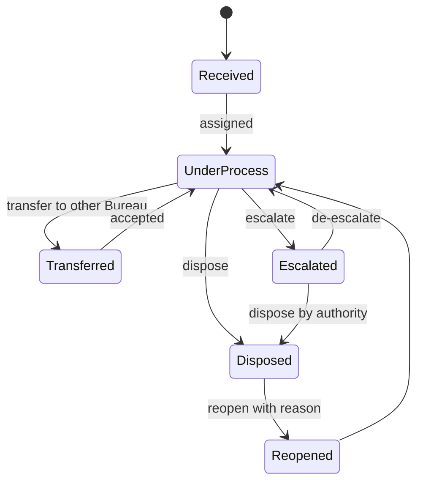

# COMPLAINT-TANTRA — System Design

Detailed design that backs `Complaint-Tantra_architecture.md`. Includes data model, APIs, scoring logic, agent contracts + system prompts, workflow state machine, RBAC, alerts, and the evaluation plan.

---

## 1. Repo structure

```
complaint-tantra/
├── apps/
│   ├── web/                  # Next.js frontend
│   └── api/                  # FastAPI backend
│       ├── routers/          # cases, institutions, overlaps, reports, alerts, auth
│       ├── services/         # case_service, entity_resolution, sla_engine, report_service
│       ├── agents/           # graph.py, intake.py, triage.py, overlap.py, web_intel.py, briefing.py
│       ├── prompts/          # versioned prompt files (v1/, v2/ ...)
│       ├── models/           # SQLAlchemy models
│       ├── schemas/          # Pydantic schemas
│       └── workers/          # celery tasks + beat schedule
├── data/
│   └── synthetic/            # generator + labelled eval set
├── eval/                     # overlap + triage evaluation scripts
├── infra/                    # docker-compose.yml, nginx, env templates
└── docs/                     # Complaint-Tantra_architecture.md, Complaint-Tantra_system.md, Complaint-Tantra_prd.md
```

---

## 2. Data model (PostgreSQL)

```sql
-- Institutions (canonical)
CREATE TABLE institutions (
  id               UUID PRIMARY KEY,
  permanent_id     TEXT UNIQUE,            -- AICTE Permanent ID (may be NULL in messy data)
  name             TEXT NOT NULL,
  name_normalized  TEXT NOT NULL,          -- lowercased, abbreviations expanded
  address          TEXT,
  city             TEXT,
  state            TEXT,
  region           TEXT,                   -- AICTE regional office
  trust_or_society TEXT,                   -- for multi-campus grouping
  name_embedding   VECTOR(1024),
  created_at       TIMESTAMPTZ DEFAULT now()
);
CREATE INDEX ON institutions USING hnsw (name_embedding vector_cosine_ops);
CREATE INDEX ON institutions (name_normalized gin_trgm_ops);

-- Cases (common schema across Bureaus)
CREATE TABLE cases (
  id                 UUID PRIMARY KEY,
  case_no            TEXT UNIQUE NOT NULL,
  institution_id     UUID REFERENCES institutions(id),
  raw_institution    TEXT,                 -- as received, for audit
  source_bureau      TEXT NOT NULL,        -- RB | PGRC | OTHER
  assigned_bureau    TEXT NOT NULL,
  assigned_officer   UUID REFERENCES users(id),
  complainant_type   TEXT,                 -- student | faculty | parent | other | suo-motu
  category           TEXT,
  subcategory        TEXT,
  text_original      TEXT,
  text_english       TEXT,
  language           TEXT,
  text_embedding     VECTOR(1024),
  status             TEXT NOT NULL,        -- see state machine
  received_at        TIMESTAMPTZ NOT NULL,
  expected_disposal  TIMESTAMPTZ,
  last_action_at     TIMESTAMPTZ,
  next_action        TEXT,
  -- AI fields (always recomputable, never the source of truth for status)
  criticality        TEXT,                 -- C1..C4
  emotion_label      TEXT,
  emotion_intensity  REAL,                 -- 0..1
  priority_score     REAL,                 -- 0..100
  priority_reasons   JSONB,
  ai_summary         TEXT,
  ai_version         TEXT
);
CREATE INDEX ON cases (institution_id);
CREATE INDEX ON cases (status, assigned_bureau);
CREATE INDEX ON cases (priority_score DESC);
CREATE INDEX ON cases USING hnsw (text_embedding vector_cosine_ops);

-- Append-only action log
CREATE TABLE case_actions (
  id          BIGSERIAL PRIMARY KEY,
  case_id     UUID REFERENCES cases(id),
  actor_id    UUID,                        -- NULL = system/agent
  actor_type  TEXT,                        -- user | system | agent
  action      TEXT,                        -- created | assigned | transferred | escalated | remark | status_change | doc_added | linked | reopened
  from_state  TEXT,
  to_state    TEXT,
  remarks     TEXT,
  payload     JSONB,
  created_at  TIMESTAMPTZ DEFAULT now()
);
-- No UPDATE/DELETE grants on this table.

-- Links between cases (overlap results + officer decisions)
CREATE TABLE case_links (
  id            UUID PRIMARY KEY,
  case_a        UUID REFERENCES cases(id),
  case_b        UUID REFERENCES cases(id),
  tier          TEXT,                      -- T1 | T2 | T3
  confidence    REAL,
  evidence      JSONB,                     -- id_match, name_score, address_score, text_sim, reasoning
  detected_by   TEXT,                      -- agent | officer
  decision      TEXT DEFAULT 'pending',    -- pending | confirmed | rejected
  decided_by    UUID,
  decided_at    TIMESTAMPTZ
);

-- Web intelligence results
CREATE TABLE web_findings (
  id              UUID PRIMARY KEY,
  institution_id  UUID REFERENCES institutions(id),
  url             TEXT NOT NULL,
  title           TEXT,
  source_name     TEXT,
  published_at    DATE,
  retrieved_at    TIMESTAMPTZ DEFAULT now(),
  summary         TEXT,
  topic           TEXT,                    -- fees | safety | accreditation | faculty | fraud | placement | court | other
  sentiment       TEXT,                    -- negative | neutral | positive
  emotion_label   TEXT,
  severity        REAL,                    -- 0..1
  match_confidence REAL,                   -- same-institution confidence
  UNIQUE (institution_id, url)
);

CREATE TABLE institution_risk (
  institution_id     UUID PRIMARY KEY REFERENCES institutions(id),
  complaint_load     REAL,
  repeat_offender    REAL,
  web_reputation     REAL,
  overlap_density    REAL,
  risk_index         REAL,                 -- 0..100
  computed_at        TIMESTAMPTZ
);

CREATE TABLE alerts (
  id UUID PRIMARY KEY, kind TEXT, case_id UUID, institution_id UUID,
  severity TEXT, message TEXT, target_role TEXT, target_user UUID,
  created_at TIMESTAMPTZ DEFAULT now(), acknowledged_at TIMESTAMPTZ
);

CREATE TABLE sla_config (category TEXT PRIMARY KEY, days_to_dispose INT, warn_before_days INT);

CREATE TABLE users (id UUID PRIMARY KEY, name TEXT, email TEXT UNIQUE, role TEXT, bureau TEXT, region TEXT, active BOOL);

CREATE TABLE agent_runs (
  id UUID PRIMARY KEY, case_id UUID, agent TEXT, model TEXT, prompt_version TEXT,
  input_hash TEXT, output JSONB, latency_ms INT, tokens_in INT, tokens_out INT, created_at TIMESTAMPTZ DEFAULT now()
);

-- Dashboard performance
CREATE MATERIALIZED VIEW mv_dashboard_counts AS
SELECT assigned_bureau, status, date_trunc('month', received_at) AS m, count(*) AS n
FROM cases GROUP BY 1,2,3;
```

---

## 3. Case status state machine



Rules: transitions are validated in code; each transition writes to `case_actions`; `Overdue` is a **computed flag** (now > expected_disposal and not Disposed), not a stored status.

---

## 4. AI scoring logic

### 4.1 Criticality taxonomy (rule + LLM)

| Code | Class | Examples | Base weight |
|---|---|---|---|
| **C1** | Safety / legal / fraud | Fake affiliation, student safety, ragging, forged documents, running unapproved courses | 1.00 |
| **C2** | Financial harm | Fee refund denial, capitation fee, scholarship misuse | 0.75 |
| **C3** | Academic / regulatory | Faculty shortage, infrastructure gaps, exam/result issues | 0.50 |
| **C4** | Administrative / service | Certificate delay, general grievance | 0.25 |

### 4.2 Emotion taxonomy

Labels: `distress`, `fear`, `anger`, `frustration`, `hopelessness`, `neutral`, `hopeful`.
Each with `intensity ∈ [0,1]`. **Safety flag** raised if text suggests self-harm, threats, harassment, or physical danger → bypasses scoring, goes straight to **"Urgent human review"**.

Emotion intensity is a *signal of urgency*, not a verdict on truth — a calm complaint about fraud still scores high through criticality.

### 4.3 Time pressure

```
time_pressure = clamp( 1 - (days_left / sla_days), 0, 1 )       # grows as deadline nears
if overdue:    time_pressure = 1 + min(days_overdue / 30, 0.5)  # up to 1.5, capped later
age_factor    = min(age_days / 90, 1)
```

### 4.4 Priority Score

```
Priority = 100 * clamp(
      0.35 * criticality_weight
    + 0.20 * emotion_intensity_weighted     # distress/fear/hopelessness count more than frustration
    + 0.25 * time_pressure
    + 0.10 * institution_risk_index/100
    + 0.10 * overlap_bonus                  # 1 if T1 link pending, 0.5 if T2/T3
, 0, 1)
```

Weights live in config; default values are tuned on the labelled synthetic set. Every component is saved in `priority_reasons`:

```json
{
  "priority_score": 87,
  "components": {"criticality": 0.35, "emotion": 0.17, "time": 0.20, "risk": 0.07, "overlap": 0.10},
  "reasons": [
    "C1: alleged unapproved course (legal/fraud)",
    "Emotion: fear (0.8) — students report threats of detention",
    "SLA ends in 3 days (7 of 10 days used)",
    "Institution has 2 open cases in other Bureaus (T1 overlap)"
  ]
}
```

### 4.5 Institution Risk Index (0–100)

```
risk = 0.35*complaint_load_norm + 0.25*repeat_offender + 0.25*web_reputation_risk + 0.15*overlap_density
```

- `complaint_load_norm`: open + last-12-month cases vs. peer percentile (same state/type)
- `repeat_offender`: share of cases re-opened or same category repeated
- `web_reputation_risk`: from recent negative, high-severity, high-confidence web findings (time-decayed, half-life ~180 days)
- `overlap_density`: number of cross-Bureau T1 links

---

## 5. Overlap detection pipeline

```python
def detect_overlaps(new_case):
    inst = resolve_institution(new_case)             # exact ID else fuzzy (below)
    candidates = open_cases(inst, exclude=new_case)  # all Bureaus
    links = []
    for c in candidates:
        same_bureau = (c.assigned_bureau == new_case.assigned_bureau)
        text_sim   = cosine(new_case.text_embedding, c.text_embedding)
        cat_rel    = category_relatedness(new_case.category, c.category)   # lookup matrix
        time_ovl   = windows_overlap(new_case, c)
        score = 0.40*inst.match_conf + 0.30*text_sim + 0.15*cat_rel + 0.15*time_ovl
        if score in GRAY_ZONE:                        # e.g. 0.45–0.70
            verdict = llm_judge(new_case, c)          # JSON: related?, reason
            score = blend(score, verdict.confidence)
        tier = assign_tier(score, text_sim, cat_rel, same_bureau)
        if tier: links.append(Link(new_case, c, tier, score, evidence=...))
    return links
```

**Institution resolution (when Permanent ID is missing):**
```
name_norm = normalize(name)    # lower, remove punctuation, expand: engg→engineering, tech→technology, coll→college
cands = trigram + embedding top-20
score = 0.5*token_set_ratio(name) + 0.3*address_ratio + 0.2*(state/city match)
accept if score ≥ 0.90  →  auto-link
        0.70–0.90       →  "needs confirmation" (shown to officer)
        < 0.70          →  new/unmatched institution
```

---

## 6. Agent contracts

All agents return **strict JSON** validated by Pydantic. Failures → retry once → fall back to rules → flag `needs_review`.

### 6.1 LangGraph skeleton

```python
from langgraph.graph import StateGraph, END

class CaseState(TypedDict):
    case: dict
    intake: dict | None
    triage: dict | None
    overlaps: list | None
    web: dict | None
    brief: dict | None
    needs_review: bool

g = StateGraph(CaseState)
g.add_node("intake", intake_agent)
g.add_node("triage", triage_agent)
g.add_node("overlap", overlap_agent)
g.add_node("web_intel", web_intel_agent)
g.add_node("brief", briefing_agent)

g.set_entry_point("intake")
g.add_edge("intake", "triage")
g.add_edge("intake", "overlap")      # parallel branches
g.add_edge("intake", "web_intel")
g.add_edge(["triage", "overlap", "web_intel"], "brief")   # join
g.add_edge("brief", END)
graph = g.compile(checkpointer=PostgresSaver(...))
```

### 6.2 Intake Agent — system prompt (v1)

```
You are the Intake Agent for AICTE's complaint system.
Task: read one complaint (may be in Hindi, English or another Indian language) and return JSON only.
Rules:
- Translate to clear English in `text_english`. Do not add facts.
- Pick exactly one `category` and `subcategory` from the provided taxonomy.
- Extract: institution_name, city, state, people_roles (not names), amounts (INR), dates, documents_mentioned.
- Write a neutral 2-sentence `summary`.
- If a required value is not in the text, use null. Never guess.
Output schema: {language, text_english, category, subcategory, entities:{...}, summary}
```

### 6.3 Triage Agent — system prompt (v1)

```
You are the Triage Agent. Given a structured complaint, return JSON only.
1) criticality: C1 (safety/legal/fraud), C2 (financial harm), C3 (academic/regulatory), C4 (administrative). Give a one-line reason.
2) emotion: one label from [distress, fear, anger, frustration, hopelessness, neutral, hopeful] and intensity 0..1.
3) safety_flag: true ONLY if the text indicates self-harm, threats, harassment or physical danger. If true, include a short `flag_reason`.
4) urgency_cues: list of phrases/facts that imply time sensitivity (exams, admissions deadline, court date).
Do not decide whether the complaint is true. Do not recommend punishment.
```
Final numeric Priority Score is computed in **code** (§4.4), not by the LLM.

### 6.4 Overlap Agent — LLM judge prompt (gray zone only)

```
You compare two complaints about possibly the same institution. Return JSON only:
{ "same_institution": bool, "same_issue": bool, "related": "same_issue|related_issue|different_issue|duplicate",
  "confidence": 0..1, "reason": "<=40 words citing specific details" }
Base your answer only on the two texts and institution fields. If unsure, lower the confidence.
```

### 6.5 Web Intelligence Agent

**Tools**: `search(query, recency)`, `fetch(url)->clean_text`, `classify(text)->{topic,sentiment,emotion,severity}`, `same_institution(article, inst)->confidence`.

**System prompt (v1):**
```
You are the Web Intelligence Agent. Goal: build a factual, cited public track record for ONE institution.
Plan 3–6 searches mixing: "<name> <city> news", "<name> complaint / fee / fraud / ragging / affiliation / court", "<Permanent ID>", AICTE/UGC/state-regulator notices, "<name> placement/accreditation" (for positives).
For each result: verify it is the SAME institution (name + city/state). If unsure, refine the query (add state/city) or discard.
Classify topic, sentiment (negative/neutral/positive), emotion tone, severity 0..1. Never state a claim without a URL and publish date.
Prefer official/regulator sources and reputed outlets; treat social posts/forums as low-weight "signals".
Stop after at most 3 refinement rounds. Report what you could NOT verify.
Return JSON: {findings:[...], reputation_summary, reputation_risk 0..100, unverified:[...]}
```

**Guardrails**: max 12 fetches per run, 24h cache, domain allow/deny list, timeout, rate-limit, `match_confidence < 0.6` → hidden by default.

### 6.6 Briefing Agent outputs
- **Case Brief** (1 page): what happened, priority reasons, overlaps, institution track record, suggested next action, SLA clock.
- **Institution Dossier**: complaint history, timeline of web findings, risk index trend.
- **Daily Digest**: "Top 10 needing attention today" per Bureau/officer.
- **Periodic report** (monthly/quarterly): tables + chart data + narrative; **numbers always come from SQL**, LLM writes only the narrative around them (prevents hallucinated stats).

---

## 7. API surface (FastAPI)

| Method | Endpoint | Purpose | Roles |
|---|---|---|---|
| POST | `/auth/login` | JWT login | all |
| POST | `/ingest/cases` | Bulk/single ingest (JSON/CSV) | admin, bureau |
| GET | `/cases` | Search + filters (institution, ID, case no, bureau, region, category, status, date range, sort=priority) | scoped |
| GET | `/cases/{id}` | Detail + timeline + AI brief | scoped |
| POST | `/cases/{id}/actions` | Remark, transfer, escalate, dispose, reopen | scoped |
| GET | `/cases/{id}/overlaps` | Related cases + evidence | scoped |
| POST | `/overlaps/{link_id}/decision` | Confirm / reject | officer+ |
| POST | `/cases/{id}/link` | Manual link | officer+ |
| GET | `/institutions/{id}` | Profile + history + risk | scoped |
| GET | `/institutions/{id}/intel` | Web findings + sentiment timeline | scoped |
| POST | `/institutions/{id}/intel/refresh` | Re-run web agent | officer+ |
| GET | `/dashboard/summary` | KPI counts | scoped |
| GET | `/dashboard/workload` | Bureau-wise workload | senior+ |
| GET | `/dashboard/heatmap` | Region-wise counts | senior+ |
| GET | `/queue/priority` | Ranked cases | scoped |
| GET | `/alerts` | Alert list | scoped |
| GET | `/reports/{type}` | Institution/Bureau/region/ageing/disposal (json/pdf/csv) | senior+ |
| POST | `/agents/replay/{case_id}` | Re-run agents (admin/debug) | admin |
| WS | `/ws/events` | Live updates for dashboard | all |

---

## 8. RBAC matrix

| Capability | Officer (RB/PGRC/other) | Regional Office | Senior Mgmt | Competent Authority | Admin |
|---|---|---|---|---|---|
| View own-Bureau cases | ✅ | ✅ (region) | ✅ all | ✅ all | ✅ |
| View other Bureau's case **summary** (for overlap) | ✅ limited | ✅ limited | ✅ | ✅ | ✅ |
| Act on assigned case | ✅ | ✅ (region) | ✅ | ✅ | — |
| Confirm/reject/link overlap | ✅ | ✅ | ✅ | ✅ | — |
| Transfer / escalate | ✅ | ✅ | ✅ | ✅ | — |
| Dispose | ✅ (own) | ✅ (own) | ✅ | ✅ | — |
| Org-wide dashboards/reports | ❌ | region only | ✅ | ✅ | ✅ |
| Approve escalations | ❌ | ❌ | ✅ | ✅ | — |
| Manage users / SLA config / weights | ❌ | ❌ | ❌ | ❌ | ✅ |

Overlap needs cross-Bureau visibility, so officers see a **redacted summary** (institution, category, status, officer contact) of the other Bureau's case, not full contents.

---

## 9. Alerts & SLA engine (deterministic)

| Alert | Trigger | To |
|---|---|---|
| **Overlap** | New T1/T2 link created | Both case officers + Bureau heads |
| **Due soon** | `days_left ≤ warn_before_days` | Assigned officer |
| **Overdue** | `now > expected_disposal` | Officer + supervisor |
| **Stuck** | No action in N days | Officer |
| **Escalation** | Case escalated or overdue > threshold | Senior mgmt |
| **Safety flag** | Triage `safety_flag = true` | Bureau head, immediately |
| **Reputation spike** | New high-severity negative finding on institution with open cases | Case officers |

Anti-fatigue: digest mode, dedupe per case/day, snooze, severity levels. Beat jobs: hourly SLA check, nightly risk-index + materialized view refresh, 6-hourly web refresh for institutions with open C1/C2 cases.

---

## 10. Synthetic data plan

| Item | Spec |
|---|---|
| Institutions | ~800 with realistic Indian names, states, regions, trusts; 15% with multi-campus siblings |
| Name noise | Abbreviations (Engg/Engineering), punctuation, typos, word reordering, missing Permanent ID (25%) |
| Cases | ~5,000 across RB, PGRC, others; multilingual (English/Hindi/Marathi samples) |
| Planted overlaps | 300 labelled T1, 300 T2, 150 T3 duplicates |
| Emotion/criticality labels | 500 hand-checked complaints for evaluation |
| Web layer | Mix of **live search** for a few real, public, well-known institutions (public data only) + cached **mock news fixtures** for repeatable demo |

---

## 11. Evaluation plan (put numbers on the slides)

| What | Metric | Target |
|---|---|---|
| Institution matching | Precision / Recall @ threshold | P ≥ 0.95, R ≥ 0.90 |
| Overlap detection | P / R / F1 per tier vs planted labels | F1 ≥ 0.85 (T1) |
| Triage criticality | Accuracy + macro-F1 vs labels | ≥ 0.80 |
| Emotion | Macro-F1 on 500-label set | ≥ 0.70 |
| Safety flag | Recall (priority) | ≥ 0.95 |
| Web agent | Same-institution precision on sampled results | ≥ 0.90; 100% of findings carry URL+date |
| Latency | Ingest → scored | < 15 s per case |
| Dashboard | p95 API time at 100k cases | < 800 ms |
| Officer feedback loop | F1 before vs after 50 confirmations | measurable improvement chart |

---

## 12. Observability & audit

- Every agent run in `agent_runs` (model, prompt version, tokens, latency) + Langfuse traces.
- Prompts versioned in repo; outputs reproducible via `/agents/replay`.
- Structured logs with request ID; failed agent runs surface as `needs_review`, never silently dropped.

---

## 13. Docker Compose (sketch)

```yaml
services:
  web:      { build: ./apps/web, ports: ["3000:3000"], depends_on: [api] }
  api:      { build: ./apps/api, env_file: .env, depends_on: [db, redis] }
  worker:   { build: ./apps/api, command: celery -A workers worker -l info, depends_on: [db, redis] }
  beat:     { build: ./apps/api, command: celery -A workers beat -l info, depends_on: [redis] }
  db:       { image: pgvector/pgvector:pg16, volumes: ["pg:/var/lib/postgresql/data"] }
  redis:    { image: redis:7 }
  minio:    { image: minio/minio, command: server /data }
  ollama:   { image: ollama/ollama, profiles: ["onprem"] }
volumes: { pg: {} }
```

---

## 14. Known risks & mitigations

| Risk | Mitigation |
|---|---|
| False overlap alerts | Confidence score + tiers + officer feedback + gray-zone LLM judge |
| LLM hallucination | JSON schema validation, numbers from SQL, citations required, "unverified" list |
| Wrong-institution news | Same-institution check, `match_confidence` threshold, officer can dismiss a finding |
| Web search cost/limits | Cache, caps, free fallbacks (News RSS/GDELT), fixtures for demo |
| Data confidentiality | PII masking, on-prem LLM profile, RBAC, audit |
| Bias / over-reliance on emotion | Emotion only 20% of score, shown transparently, human decides |
| Demo failure | Offline fixtures + recorded fallback video |
